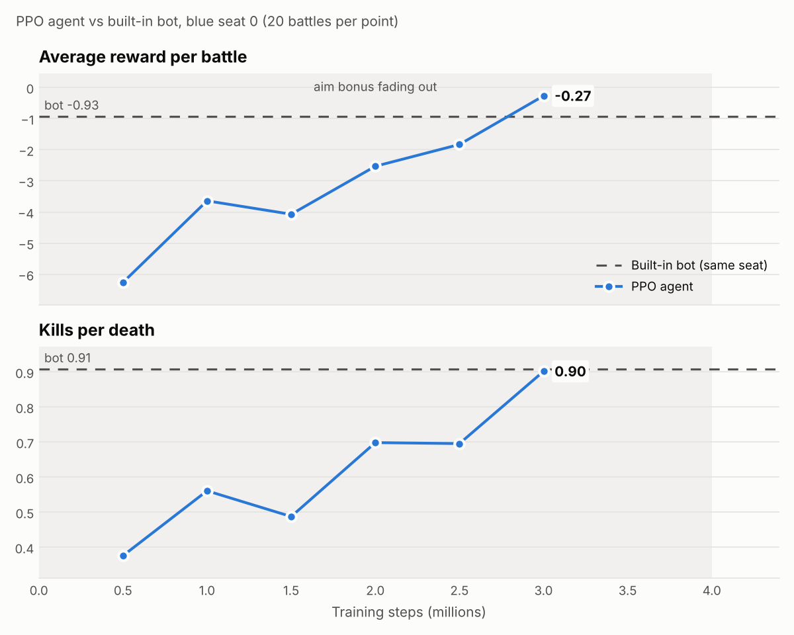

# Asteroids 5v5

Two fleets of five triangle ships fight it out in an Asteroids-style arena.

- **Watch it in the browser:** https://crunchy000.github.io/astorids/ (`index.html`, scripted AI on both sides). It has synthesised sound effects (lasers, hits, explosions, asteroid thuds, panned by position): press any key to start audio, and M to mute.
- **Train agents in Python:** `astroids_gym`, a [Gymnasium](https://gymnasium.farama.org/) (the maintained successor to OpenAI Gym) and [PettingZoo](https://pettingzoo.farama.org/) port of the same game.

## Rules

Two rule sets, the same in the browser (press **C** to switch, or `?rules=classic`) and in Python (`Config()` / `Config.competitive()`):

- **Classic:** endless battle; ships respawn after 3 s; score = kills.
- **Competitive** (the browser default): 60-second battles with
  - **Control zone:** the team with more living ships inside the centre circle gains 1 point per second, and every 3 zone points earn it an extra respawn (reinforcements). Score = kills + zone points.
  - **Weapon heat:** each shot adds 0.25 heat; at 1.0 the gun locks until it cools to 0.5 (cooling 0.35/s), so bursts are fine but spraying isn't.
  - **Shorter guns:** 384 px range (bullets live 0.8 s instead of 1.3 s), so the spawns are out of each other's range and teams have to move to fight.
  - **Limited respawns:** 20 per team (plus zone reinforcements), 4 s timer. A team wiped out with none left loses outright; otherwise the higher score wins at the buzzer.
  - **Friendly fire:** bullets hit teammates (never the shooter).
  - **Fair spawns:** each team spawns in the middle of its own half (at least 0.3 of the map width from the enemy spawn either way, instead of ~0.2 across the wrap seam), facing the zone; a respawning ship takes the safest of 8 candidate points, and spawn protection lasts 2 s. With bots, ships dying within 3 s of respawning fell from 40% to 28%, and zone points per battle rose from ~6 to ~22.

The bots contest the zone when no enemy is near. For agents, `ObsConfig(extended=True)` adds 32 observation inputs for the rules (heat, zone position and control, score lead, respawns and ships left, time remaining, nearby teammates' bullets), and `RewardConfig` has `zone`, `friendly_hit`, `win` and `crash` (dying to an asteroid or a ram, on top of `death`) terms.

## Install

```bash
pip install -e .                  # core env: gymnasium + numpy
pip install -e ".[render]"        # + pygame for render_mode="human" / "rgb_array"
pip install -e ".[multiagent]"    # + pettingzoo for the multi-agent env
pip install -e ".[train]"         # + stable-baselines3 + torch for the example trainer
pip install -e ".[video]"         # + pygame + imageio/ffmpeg for MP4 recording
```

## Single-agent env (Gymnasium)

You fly one blue ship. The other nine are flown by the built-in scripted bot, the same AI the web page uses, unless you swap in other policies.

```python
import gymnasium as gym
import astroids_gym  # registers the env

env = gym.make("AsteroidsBattle-v0", render_mode="human")
obs, info = env.reset(seed=0)
for _ in range(1800):
    obs, reward, terminated, truncated, info = env.step(env.action_space.sample())
    if terminated or truncated:
        obs, info = env.reset()
```

| | |
|---|---|
| **Action** | `MultiDiscrete([5, 2, 2])` = (turn: full left / slow left / none / slow right / full right, thrust off/on, fire off/on). The slow turns give the fine aim control the bot gets from steering continuously. |
| **Observation** | `Box(-1, 1, (160,))`, relative to your ship: your own velocity, heading, HP, cooldown; the 5 nearest enemies (position, relative velocity, relative heading, HP, and the *lead direction*, i.e. where to point so a shot fired now hits); the 4 nearest allies (the same without lead); the 8 nearest enemy bullets; the 5 nearest asteroids. Empty slots are zero, and each slot has a "present" flag. Details are in `astroids_gym/obs.py`. |
| **Reward** | +1 kill, −1 death, +0.2 hit dealt, −0.2 hit taken, plus optional aim shaping (below). All set with `RewardConfig`. |
| **Episode** | Ships respawn, so an episode ends only at `max_steps` (default 1800 agent steps = 60 s of game time). `terminate_on_death=True` gives shorter episodes. |
| **Timing** | Physics runs at 60 Hz; the agent acts every `frame_skip=2` ticks (30 Hz). |

Useful kwargs: `teammates=` / `opponents=` take `"scripted"`, `"idle"`, `"random"` or a callable, so you can do self-play against frozen policies. A callable gets one batch of observations for all the ships it flies, shape `(n, 160)`, and returns `(n, 3)` actions, so an SB3 model plugs straight in: `opponents=lambda obs: model.predict(obs)[0]`. You can also pass `config=Config(asteroids=False, team_size=3, ...)`, `reward_config=RewardConfig(...)` and `obs_config=ObsConfig(...)`. `env.step(None)` lets the built-in bot fly your ship, which gives a baseline in exactly the same seat.

### Aim shaping

`RewardConfig(aim=0.01)` adds up to `aim` per step for pointing where a shot fired now would hit the nearest enemy in range. The bonus is a Gaussian in the aim error (`aim_width`, default 0.15 rad). Kills are rare early in training, so this gives the agent a signal long before it lands one. Fade it out before the end of training so the final pilot optimises the real score: `train_ppo.py` does this for you, and `env.set_reward_weights(aim=...)` changes it mid-run.

## Multi-agent env (PettingZoo Parallel API)

```python
from astroids_gym import parallel_env

env = parallel_env(learning_teams=("blue", "red"))   # all 10 ships are agents (self-play)
# env = parallel_env(learning_teams=("blue",))       # 5 blue agents vs the scripted red team
obs, infos = env.reset(seed=0)
while env.agents:
    actions = {a: env.action_space(a).sample() for a in env.agents}
    obs, rewards, terminations, truncations, infos = env.step(actions)
```

Agents are named `blue_0..4` / `red_0..4`. `env.state()` returns the global state for centralised critics (MAPPO, QMIX and similar). `RewardConfig(team_spirit=0.5)` mixes teammates' kills and deaths into each ship's reward.

## Training

```bash
python examples/evaluate.py                      # baseline: the built-in bot flies blue seat 0
python examples/evaluate.py --model random       # baseline: random pilot
python examples/train_ppo.py --n-envs 8 --stop-when-beats
python examples/evaluate.py --model models/ppo_pilot_best.zip --render
# self-play: the next generation trains against the previous one flying the red team
python examples/train_ppo.py --opponent-model models/ppo_pilot_best.zip --out models/ppo_gen2
```

`train_ppo.py` runs PPO with aim shaping (`--aim 0.01`, faded to 0 over `--aim-anneal` steps). Every `--eval-every` steps it plays the pilot and the built-in bot in the same seat on the same 20 seeds, scored with the plain game reward. It keeps the best model as `<out>_best.zip`, logs every evaluation to `<out>_eval.json`, and redraws the progress chart `<out>_eval.png` each time (`examples/plot_progress.py` draws it for any run). `--stop-when-beats` stops training once the pilot beats the bot on both mean return and K/D.

Speed: the bare env runs about 2,800 agent steps/s per process (pure Python, nine scripted bots). With PPO in the loop, a 4-core machine manages about 900 steps/s end to end, so set `--n-envs` to your core count. The trainer keeps PyTorch to one thread (`--torch-threads`) so it doesn't starve the env workers.

## Results: a PPO agent that beats the bot

`results/ppo_pilot.zip` was trained with the default `train_ppo.py` settings on 4 CPU cores, about 1.5 hours and 3.5M steps. The aim bonus started at 0.01 and faded to zero by 4M steps. To confirm, it was then evaluated on 50 battles that training never saw, against the built-in bot flying the same seat in the same battles:

| Blue seat 0 flown by | Avg reward | Kills | Deaths | Kills per death |
|---|---|---|---|---|
| **PPO agent** | **+2.03** | 6.1 | **5.2** | **1.16** |
| Built-in bot | −1.17 | 7.3 | 8.1 | 0.90 |

The agent wins mostly by staying alive: it dies about a third less often and still trades kills better than the bot. Training progress (20 battles per point):



Watch them on the website: https://crunchy000.github.io/astorids/videos.html (also linked from the game page). Videos (60 s with sound, same battle seed): [agent in seat 0](results/agent_seat0.mp4) · [bot in seat 0](results/bot_seat0.mp4).

On its own this agent doesn't help a whole team: when it flies all five blue ships, the team does about as well as an all-bot blue team (8 vs 10 wins out of 20 battles). Team training (below) fixes that.

## Team training

```bash
python examples/train_team.py --init results/ppo_pilot.zip --n-workers 4
```

One shared policy flies all five blue ships against the scripted red team (parameter sharing: each ship acts on its own observation, and all their experience trains the same network). Each worker process runs one battle, and every blue ship is one slot of the SB3 VecEnv. `--team-spirit 0.5` gives each ship half of its teammates' kill and death rewards, so ships care about the team result. Every `--eval-every` samples the team plays 40 fixed battles, scored by win rate and average kill margin against an all-bot blue team on the same battles. Progress goes to `<out>_eval.json` / `<out>_eval.png`, and the best model to `<out>_best.zip`.

### Team results

Starting from `results/ppo_pilot.zip`, `train_team.py` reached a 90% win rate (+9.8 average kill margin) over 40 evaluation battles after 2M ship-steps, and won every evaluation battle from 3M on (+18.8 at 4M), in about 35 minutes on 4 cores. An all-bot blue team wins 50% (−0.8). On 50 battles it had never seen, the 3M model won 98% (+15.4) where the all-bot team won 40% (−1.6). The 4M model is `results/ppo_team.zip`, with the progress chart `results/team_progress.png` and videos of the same battle: [team-trained blue wins 47–27](results/team_trained.mp4) · [all-bot blue loses 34–44](results/team_bots.mp4).

## League: teams of agents vs teams of agents

```bash
python examples/train_league.py --init results/ppo_team.zip --rounds 12 --bots-share 0.4
python examples/plot_league.py league/league.json          # Elo chart + who-beats-whom table
python examples/record_match.py --blue league/models/striker_r12.npz --red bots
```

`train_league.py` trains several shared-policy team models, each with its own reward personality (`striker`: kills first; `guardian`: survival first; `pack`: fully shared team rewards and the zone). Each round, every member trains against the other members' latest versions, past snapshots and the bots (`--bots-share`), on a random side each battle. A side-swapped round-robin tournament after every round gives Bradley-Terry Elo ratings with the built-in bots fixed at 1000. `--resume` continues a run from its last finished round. It runs at about 11,000 samples/s on 4 cores: battles step in multi-battle worker processes, opponents use NumPy copies of the policy, observations come from the numba encoder, and BLAS is pinned to one thread per process.

Results on the competitive rules (`results/league_*`): 12 rounds of 1M ship-steps per member, about 1.5 hours. All three started from the classic-rules team champion, which the bots beat 98% of the time under the new rules. Its spray-and-camp habit kept its guns overheated 46% of the time, so the league rewards include an overheat penalty and a small shot cost from round 4. After that, the **striker** broke away and finished level with the bots:

| Team (round 12) | Elo (bots = 1000) | vs starting champion |
|---|---|---|
| Striker | 988 | +410 |
| Pack | 617 | +39 |
| Starting champion | 578 | — |
| Guardian | 466 | −112 |

On 60 fresh battles the striker won 42% (± 6%) against the bots and 87% against the starting champion. The survival-first guardian ended below where it started. Charts: `results/league_elo.png`, `results/league_matrix.png`; models: `results/league_{striker,pack,guardian}.zip`; videos: [striker vs bots](results/league_striker_vs_bots.mp4) · [striker vs pack](results/league_striker_vs_pack.mp4).

## Population-based training: evolving teams

```bash
python examples/train_population.py \
    --founders results/league_striker.zip:striker,results/league_pack.zip:pack,results/league_guardian.zip:guardian \
    --size 8 --rounds 16
python examples/plot_population.py population/population.json   # Elo/width chart + lineage map
```

Each member is a team model with a **genome**: its reward weights, learning rate, entropy bonus and network width. The population starts from founder models with mutated genomes. Every round, each member trains (against the others, past snapshots and the bots) and everyone plays a side-swapped tournament (Elo, bots = 1000). Every `--exploit-every` rounds, the bottom quarter is replaced by copies of the top quarter: weights, optimiser state and genome. Each copy then **mutates**: reward weights, learning rate and entropy are scaled by 0.8 or 1.25, and with probability `--p-grow` its network widens by 64 units per layer.

**Networks can grow.** `grow_model()` (in `train_league.py`) widens a trained network without changing its play: old weights are copied, inputs from new units start at zero, and new units keep a random incoming init so they can learn. A grown network plays identically at first (same actions on every test observation, value estimates within 1e-6), and selection decides whether the extra capacity pays off. The same function adds new observation inputs.

Results (`results/population_*`), 8 members, 16 rounds, about 3 hours on 4 cores: the guardian line died out by round 2 and pack by round 6, and striker descendants took over and kept improving. The median member rose from Elo ~660 to ~1260, and the best ended at 1311 (peak 1349). The winner, **m16** (m06 → m13 → m14 → m16, grown to 320 units in round 10), evolved to value kills (2.3 vs 1.5) and winning (3.75 vs 3.0) more, with a slower learning rate. On 60 fresh battles:

| Matchup | Win rate |
|---|---|
| Evolved m16 vs built-in bots | **77% ± 5%** |
| Evolved m16 vs league striker | **87% ± 4%** |
| League striker vs built-in bots | 48% |

Half the final population had grown networks (320 to 384 units). Bigger networks were often but not always selected: the first one grown (m11) was culled, while m15 and m16 (320) and m17 (384) reached the top. The model is `results/population_best.zip`; videos: [m16 vs bots](results/population_best_vs_bots.mp4) · [m16 vs league striker](results/population_best_vs_striker.mp4).

## Getting smarter

### A gauntlet to measure it

```bash
python examples/gauntlet.py results/attention_best.zip results/population_best.zip --battles 40 --json g.json
python examples/plot_gauntlet.py g.json --out gauntlet.png
```

Elo inside one population only says who beats whom *there*. The gauntlet scores a team against fixed, varied opponents on fresh battle seeds, from both sides: the default bots; three bot styles that punish different weaknesses (`bots:rusher` charges to point-blank range, `bots:sniper` holds at long range, `bots:zone` sits in the control zone); a hall of fame (league striker, m16, the attention model and Colab m08; a team never plays itself); and twelve bot teams that fly a formation or a tactic (below). The gauntlet score is the mean win rate, so it only goes up if a team gets better against everything. The scores published up to and including the first Colab run used the original two-model hall of fame (league striker, m16) and no formation bots.

### Training upgrades

`train_population.py` now has four upgrades. Each can be switched off for comparison.

* **A critic that sees the whole battle** (`--critic central`, `astroids_gym/policies.py`). The value network also reads the global state (`obs.global_state`: every ship, both teams' respawns and zone points, the clock), while the actor still flies from its own ship's view. Existing models convert with identical actions and values.
* **Prioritised opponents** (`--sampling pfsp`). Each member keeps its record against every opponent and picks opponents with weight (1 − p)², where p is its win rate against them. Hard opponents come up often, easy ones rarely, and the bots' share is spread over the bot styles the same way.
* **Exploiters** (`--exploiters`). Extra models train only to beat the current best member. When one wins 65% of a 40-battle check, its snapshot joins every member's opponent pool, so the population must fix the weakness it found.
* **Line protection.** Selection never removes the last member of a founder line, so different reward personalities stay in play.

### Attention over entities

```bash
python examples/distill.py --teacher results/population_best.zip --out entity_student.zip
python examples/train_population.py --founders results/population_best.zip:evolved,entity_student.zip:evolved \
    --size 2 --exploiters 0 --exploit-every 1000 --rounds 8 --tournament-battles 40
```

`EntityPolicy` treats every ship, bullet and asteroid in view as a separate token with its own embedding, shared across slots. One transformer layer lets the tokens attend to each other, with absent slots masked out. The ship's own token and the mean over present entities then feed the usual MLP head. The critic stays a centralised MLP. A NumPy version (`astroids_gym/entity.py`, tested equal to the torch one) lets workers and tournaments play it without torch.

Training it from scratch would throw away what m16 learned, so `distill.py` first trains it to copy m16. Over 120 battles against varied opponents it learns m16's action probabilities, then two DAgger rounds let it fly while m16 labels what it should have done. The copy won 40% against m16 and 83% against the bots. Then the copy and an MLP twin of m16 trained side by side for 8 rounds (3.2M samples each) with identical settings: centralised critic, prioritised opponents, bot styles.

| Opponent (40 fresh battles each) | Attention | MLP twin | m16 (start) |
|---|---|---|---|
| **Gauntlet score** | **91%** | 87% | 86% |
| vs m16 | 70% | 57% | — |
| vs built-in bots | 95% | 82% | 82% |
| vs rusher / zone / sniper bots | 95% / 98% / 100% | 90% / 92% / 100% | 75% / 82% / 100% |
| vs league striker | 90% | 98% | 90% |

Head to head on fresh seeds, the attention model's last three snapshots beat the MLP twin's in 62% of 180 battles (± 4%). Per training sample, attention learns a better policy, especially against the rusher and zone bots that troubled m16. Per hour it is costlier: on 4 CPU cores it trains at about 1,200 samples/s against 4,800 for the MLP, and its NumPy forward pass is about 20 times slower. The model is `results/attention_best.zip`; chart `results/gauntlet.png`; videos: [attention vs m16](results/attention_vs_m16.mp4) · [attention vs bots](results/attention_vs_bots.mp4) · [attention vs population v2's best](results/attention_vs_v2.mp4).

### Population v2: the training upgrades on their own

```bash
python examples/train_population.py --size 10 --exploiters 2 --rounds 8 --tournament-battles 10 \
    --founders results/population_best.zip:evolved,results/population_best.zip:pack,results/population_best.zip:guardian
```

Ten MLP team models, all starting from m16 with three reward personalities, trained with all four upgrades for 8 rounds (about 2.5 hours alone on 4 cores; 16 were planned). An exploiter beat the leader once (65% at round 4), and line protection kept one guardian member alive. The gain was small. The best members rated 50 to 100 Elo above the unchanged m16 in their own tournaments, but on the gauntlet:

| Team (40 fresh battles per opponent) | Gauntlet score | vs m16 | vs bots |
|---|---|---|---|
| Population v2 best (m17) | 86% | 50% | 92% |
| Population v2 m00 (m16 itself, retrained) | 85% | 70% | 75% |
| m16 (start) | 86% | — | 82% |
| Attention model | **91%** | **70%** | **95%** |

v2's best beat the bots and the rusher style more often than m16, but only broke even against m16 itself. With the same number of training samples per model, the attention model got further, so for these MLP models the network, not the training method, now looks like the limit. Model `results/population_v2_best.zip`; charts `results/population_v2_{elo,lineage}.png`; video: [v2 best vs m16](results/population_v2_vs_m16.mp4) (a near tie, 29.4 to 29.9).

### Train on a GPU (Google Colab)

[](https://colab.research.google.com/github/Crunchy000/astorids/blob/ccr-ccbf1ca0-erm5dw/colab/train_on_colab.ipynb)

`colab/train_on_colab.ipynb` trains a population of attention-model teams on a Colab GPU: pick a GPU runtime and *Run all*. It saves every round to Google Drive, so after a disconnect *Run all* carries on from the last finished round. Then it scores the best member on the gauntlet, records a video, and can push the results to a `colab-results` branch (with a GitHub token stored as a Colab secret).

On a GPU, `train_population.py --device auto` trains there, and `--inference main` (the default with a GPU) runs every network in the main process. That covers the frozen opponents and tournament players, batched across all battles (`policies.PolicyBank`, `league.play_matches`), so the CPU worker processes only simulate battles. This matters because Colab gives 2 CPU cores, and an attention opponent costs ~8 ms per batch in NumPy. Tournament results are identical either way (tested). `gauntlet.py --device cuda` does the same for evaluation.

### First Colab run: an attention population

```bash
python examples/train_population.py --size 6 --exploiters 1 --rounds 12 --samples-per-round 400000 \
    --battles-per-worker 24 --tournament-battles 10 --device auto \
    --founders results/attention_best.zip:evolved,results/attention_best.zip:pack,results/attention_best.zip:guardian
```

Six attention-model teams, all starting from the attention model with three reward personalities, plus one exploiter, trained for 12 rounds (400k samples per member per round) on a Colab L4 GPU with 12 CPU cores. Training ran at about 9,000 to 11,000 samples/s, so each round took about 350 s and the whole run took 70 minutes, using 2.3 Colab compute units. The evolved line took over: the best member, m08 (an evolved member whose network grew to 384 units), led the last three rounds' tournaments at about 1,550 Elo, against 1,330 to 1,430 for the unchanged starting model. The exploiter never beat the leader (45 to 52%).

| Team (40 fresh battles per opponent) | Gauntlet score | vs m16 | vs league striker | vs bots |
|---|---|---|---|---|
| **Colab population best (m08)** | **95%** | **85%** | **98%** | **98%** |
| Attention model (start) | 91% | 70% | 90% | 95% |

Head to head on 100 fresh battles, m08 beat the attention model it started from 66% of the time, though by a small average margin (+1.7 points per battle). Model `results/colab_population_best.zip`; charts `results/gauntlet.png`, `results/colab_population_{elo,lineage}.png`; video: [m08 vs the attention model](results/colab_best_vs_attention.mp4) (one of the battles m08 loses, 25.8 to 26.1).

### Careless flying: crashes and friendly fire

Over 12 battles against the default bots, m08 lost nearly a third of its ships to its own mistakes:

| Cause of death | m08 | Default bots |
|---|---|---|
| Asteroids | 52 (19%) | 28 (9%) |
| Friendly fire | 30 (11%) | 8 (3%) |
| Ramming an enemy | 5 (2%) | 11 (3%) |
| Enemy bullets | 191 (69%) | 274 (85%) |

The ships can see the nearest asteroids, enemies and teammates' bullets, but the reward barely cared: in m08's line, a death cost −0.5 against +2.3 for a kill, and a friendly-fire hit cost −0.3. The simulation now counts crashes (`Events.crashes`: deaths from an asteroid or a ram), and `RewardConfig.crash` penalises them on top of `death`. Every personality now has `crash: -1.5`, and friendly fire costs −0.6 (−0.8 for the guardian). Runs started from the founders pick these up; resumed runs keep the genomes they already have.

### Formations and tactics for the bots

```bash
python examples/record_match.py --blue bots:pincer --red bots --out pincer.mp4
```

Fifteen new scripted bot styles (`astroids_gym/bot.py`), all chosen with `scripted_action(..., style=...)` or as `bots:<style>` wherever a team is named.

**Formations and team tactics** (`FORMATIONS`, `formation_action`). Each ship takes a slot in a shape centred on its team's centre of mass and facing the objective: the control zone while the enemy is far, then the enemy. Slots go left to right in the order the ships already stand, so nobody crosses over. Each ship holds station by thrusting along its velocity error, turning round to brake. With a target in range a ship turns and shoots, and thrusts back toward its slot when it happens to face it.

* **Wedge**: a leader in front, the others swept back on both sides.
* **Line**: shoulder to shoulder, 70 px apart.
* **Echelon**: a diagonal line; one side leads and the other is held back (a refused flank).
* **Finger four**: the fingertips of a hand seen from above. The leader is in front, its wingman back on one side, the second element back on the other, and the fifth ship trails.
* **False gap**: a line with a hole in the middle. When the enemy comes within range, the centre falls back to draw them in while the flanks push forward and close. Once the enemy is inside 60% of gun range, everyone fights.
* **Pincer** (double envelopment): the centre holds while two horns swing wide and close round both sides of the enemy.
* **Hammer and anvil**: three ships hold a line while the other two swing out to one side and strike the enemy's flank.
* **Cantabrian circle**: the team rides a rotating ring toward the enemy, so every ship keeps moving and passes the front in turn.
* **Lufbery circle**: a defensive rotating ring held over the control zone, each ship covering the tail of the one ahead.
* **Feigned retreat**: a line that turns and runs when the enemy comes close, then turns on them inside 55% of gun range. The bots have no memory, so the feint runs on a clock (at most 3 s in every 10).

**Fighting pairs** (`PAIRS`, `pair_action`). The team splits into leader-wingman pairs, and the leader fights like the default bot.

* **Fighting pair**: the wingman holds 70 px behind and to one side of its leader and shoots what the pair meets.
* **Thach weave**: the pair flies line abreast, 160 px apart. When an enemy sits on one ship's tail, that ship turns hard toward its partner, dragging the attacker across the partner's guns, while the partner turns into the attacker and fires.

**Dogfight manoeuvres** (`MANEUVERS`, `maneuver_action`). These are the default bot plus a defensive move whenever an enemy is on its tail (behind it, within 80% of gun range and pointing at it).

* **Break turn**: a hard turn across the attacker's line of fire at full thrust.
* **Flat scissors**: throttle back and reverse the turn every 0.7 s, so a faster attacker overshoots.
* **Skid** (flat-scissors drift): cut the engine and spin round to face the attacker, sliding on momentum while firing back.

Win rates against the other bots (40 battles each) and against m08, the best trained team (20 battles each), from both sides under the competitive rules:

| Style | | vs default bots | vs rusher | vs sniper | vs zone | vs m08 (20 battles) |
|---|---|---|---|---|---|---|
| `bots:wedge` | Wedge | 98% | 92% | 100% | 90% | 15% |
| `bots:line` | Line | 98% | 92% | 100% | 90% | 40% |
| `bots:echelon` | Echelon | 95% | 92% | 98% | 92% | 15% |
| `bots:fingerfour` | Finger four | 98% | 95% | 100% | 88% | 50% |
| `bots:falsegap` | False gap | 80% | 90% | 100% | 65% | 15% |
| `bots:pincer` | Pincer | 98% | 95% | 100% | 92% | 40% |
| `bots:hammer` | Hammer and anvil | 88% | 92% | 100% | 82% | 10% |
| `bots:circle` | Cantabrian circle | 95% | 95% | 95% | 92% | 30% |
| `bots:lufbery` | Lufbery circle | 95% | 95% | 100% | 92% | 10% |
| `bots:retreat` | Feigned retreat | 72% | 75% | 78% | 57% | 10% |
| `bots:pair` | Fighting pair | 60% | 65% | 98% | 60% | 5% |
| `bots:thach` | Thach weave | 55% | 42% | 98% | 55% | 5% |
| `bots:break` | Break turn | 40% | 30% | 92% | 48% | 5% |
| `bots:scissors` | Flat scissors | 32% | 32% | 95% | 42% | 0% |
| `bots:skid` | Skid (flat-scissors drift) | 48% | 38% | 98% | 46% | 10% |

Flying together pays off. Every formation and team tactic beats the default bots (72 to 98%). The false gap and the feigned retreat win less often because they give up the control zone while they fall back. The pairs only break even, because their leaders fly like the default bot.

The dogfight manoeuvres don't help at all (32 to 48% against the default bots). In this game a ship turns at 4.2 rad/s (a full circle in 1.5 s), and its nose isn't tied to its direction of travel, so it can spin round and shoot backwards while sliding. An attacker never stays on anyone's tail long enough for a break or a scissors to matter. For those manoeuvres to mean something, the game would need flight-like rules: turn rate depending on speed, and turning that bleeds energy.

Against m08 the order changes. The finger four wins half its battles, and the line and the pincer win 40%, a real test for a trained team. The rest win 5 to 30%, and m08 beats the default bots 95% of the time. With 20 battles each, these rates are about ±11%.

The arena is small, so the shapes mostly show on the approach and when a team regroups. Contact comes about 2 to 3 seconds after the start, and then it becomes a close fight. Twelve of the styles (every formation and tactic, plus the Thach weave and the skid) are gauntlet opponents, placed after the hall of fame so the other opponents keep their battle seeds. All fifteen are in `train_population.py`'s opponent pool. Videos of each against m08 are on the [videos page](videos.html).

### Colab run 3: crash penalties and the formation bots

```bash
python examples/train_population.py --size 6 --exploiters 1 --rounds 16 --samples-per-round 800000 \
    --battles-per-worker 4 --tournament-battles 10 --device auto \
    --founders run2/m05_r5.zip:guardian,run2/m05_r5.zip:evolved,run2/m04_r5.zip:pack
```

Run 2 (the same settings from m08, before the crash penalty) stopped after 5 rounds when Colab reclaimed the runtime; its best members (m05, m04) seeded run 3. Run 3 trained with the crash and friendly-fire penalties, and with every formation and tactic bot in the opponent pool, for 16 rounds of full battles (about 25 minutes each, 6.7 hours in all, about 10 Colab compute units). The evolved line took over again. The best member, m16 (a mutated copy of m11), averaged about 1,700 Elo over the last two rounds, against about 1,370 for the unchanged starting model. The exploiter never beat a leader (28 to 48%).

| Team (40 fresh battles per opponent) | Gauntlet score | vs m08 | vs attention model | vs line bots | vs finger four bots | vs pincer bots |
|---|---|---|---|---|---|---|
| **Colab run 3 best (m16)** | **98%** | **80%** | **90%** | **100%** | **100%** | **92%** |
| Colab m08 (before) | 83% | | 72% | 52% | 62% | 62% |

This gauntlet includes the twelve formation bots, which is why m08 scores 83% here against 95% on the older one. Head to head over 100 fresh battles, m16 beat m08 88% of the time (+5.2 points per battle). The run-3 m16 is a different model from the league-era "population m16" in the hall of fame.

Careless flying fell, but only a little. Over the same 12 battles against the default bots, m16 lost 43 ships to asteroids (17% of its deaths, down from m08's 19%) and 22 to friendly fire (9%, down from 11%), against 23 and 7 for the bots. It still loses about twice as many ships to its own mistakes as the bots do.

Model `results/colab_run3_best.zip`; charts `results/gauntlet_run3.png`, `results/colab_run3_{elo,lineage}.png`; video: [m16 vs m08](results/colab_run3_vs_m08.mp4) (m16 wins 36.4 to 28.1).

### Colab run 4: more of the same stops paying

Run 4 restarted from run 3's best (m16 for the evolved and guardian lines, m11 for the pack line) with the same settings, planned for 24 rounds. From round 5 on, the unchanged copy of m16 led or tied every tournament, and by round 14 it led on 1,528 Elo against 1,433 for the best new member; the guardian line collapsed. The run was stopped after 14 rounds (about 6 hours, about 8 compute units), and m16 stays the best model. More rounds with the same rewards and learning rates no longer help; a lower learning rate or different rules are the next things to try. Chart: `results/colab_run4_elo.png`.

### Where the training time goes

On this 4-core CPU with the centralised critic, one PPO iteration splits about 49% PPO update, 29% battle simulation and 22% network inference. The collision checks and the scripted bot were sped up without changing any result: 12 full battles of trajectories and 288k bot actions are bit-identical, and the physics step is about 1.4x faster. That only saves about 5% end to end. The network maths is now the bottleneck, so a GPU (or fewer PPO epochs) is where a big speed-up would come from.

## Videos

```bash
python examples/record_video.py --model models/ppo_pilot_best.zip --out videos/pilot.mp4         # pilot flies blue ship 0
python examples/record_video.py --model models/ppo_pilot_best.zip --team --out videos/team.mp4   # pilot flies all of blue
python examples/record_video.py --out videos/bot.mp4                                             # built-in bot, for comparison
```

`--seconds` sets the length (default 60) and `--seed` picks the battle. Videos are 1280×720 at 30 fps with a synthesised stereo soundtrack matching the browser game's sound effects (`--no-sound` to skip it; the synth is in `astroids_gym/audio.py`). Inside your own code, `render_mode="rgb_array"` returns frames from either env.

## Tests

```bash
pip install -e ".[dev]" && pytest
```

The tests cover Gymnasium's `check_env`, PettingZoo's `parallel_api_test`, seeded determinism, truncation and termination, aim shaping, batched policies, the bot baseline, and rendering.

Note: the Python simulation reimplements the browser game with the same constants and rules. It isn't a byte-for-byte replay of the JavaScript.
