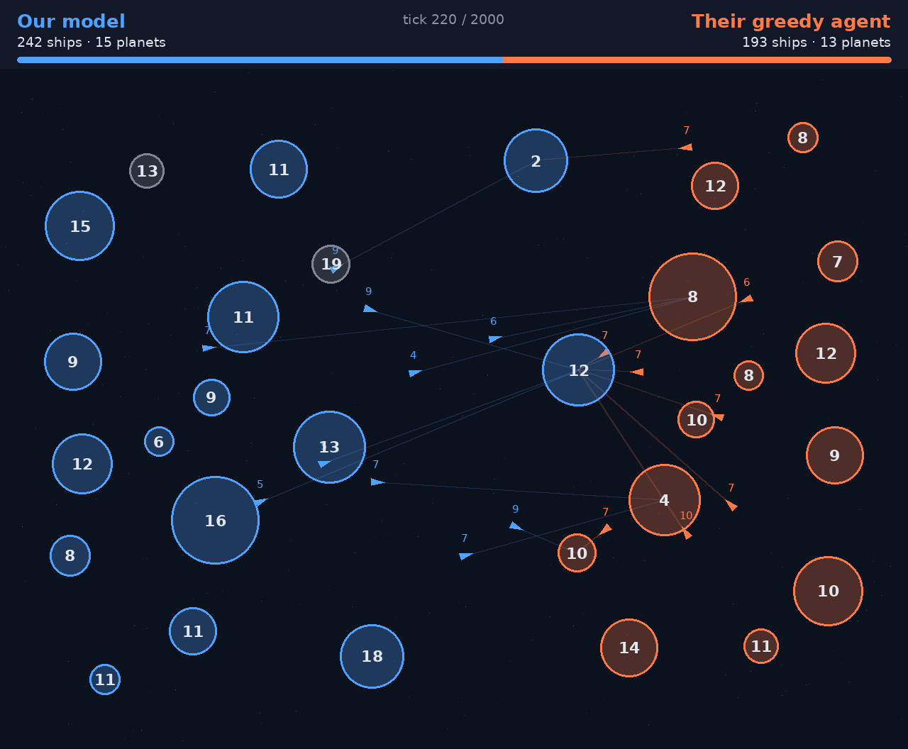

# Planet Wars RTS entry, trained with JAX

An entry for Simon Lucas's [Planet Wars RTS](https://simonlucas.github.io/planet-wars-rts/) league.
The entry served by default is an all-moves planner (`entry/planner.py`) whose best few launches are
re-ranked by a small network (`entry/value.npz`, a faster copy of one trained on the results of planner games, then
trained to predict its own later values), then plays its four best options 30 ticks forward, both sides moved by
the planner, and picks the one that ends up best, all within 150 ms of a move. Without that
file, or with `PW_VALUE=off`, it ranks launches by a hand-written score alone. A neural network
trained by self-play on a GPU is also in the repo (`PW_AGENT=neural`); the planner beats it in 57 of 60
games. The game itself is untouched: we port its rules to JAX so thousands of games run in parallel,
then ship a numpy copy of the network in their Python entry format.

```
planetwars/
  pwjax/           training code (JAX)
    maps.py        map generator, same as their Kotlin GameStateFactory + GameParamGenerator
    env.py         the forward model (ForwardModel.kt / forward_model.py), rule for rule
    baselines.py   their Greedy Heuristic and Careful Random sample agents
    policy.py      sampling and log-probabilities for PPO
    ppo.py         self-play PPO against itself, older snapshots and the sample agents
    evaluate.py    win rates against the sample agents or another model
    planner.py     the planner in JAX (checked against entry/planner.py)
    lvalue.py      planner games, value training and head-to-head tests for the learned value
  entry/           the competition entry (copy to the root of a repo to submit)
    Dockerfile     their Python template: python:3.11-slim, port 8080
    main.py        GameServerAgent(host="0.0.0.0", port=8080, agent=PlannerAgent()); PW_AGENT=neural serves the network
    planner.py     the all-moves planner (numpy only), the default agent
    value.npz      value network that re-ranks the planner's best launches (a 2-layer copy of round 6, then two
                   rounds of self-predicting targets, see below)
    agent.py       the neural agent (numpy only)
    pwnet.py       features + network, shared verbatim with training (numpy or jax.numpy)
    model.npz      trained weights (self-play iteration 450)
    selfcheck.py   play the official sample agents in the official Python engine
    core/ agents/ client_server/   vendored from planet-wars-rts (MIT, see LICENSE-planet-wars-rts)
  tests/           parity tests against the official engine
  tools/           record_game.py (render a game as an MP4), remote_match.py, TraceGame.kt + render_trace.py + aura.py (our entry vs TeamTitansAgentV3 as an MP4, Auralux-style),
                   aura_sound.py (the soundtrack of both: the browser game's sound effects and music)
  media/           recorded games: against their greedy agent, and two against TeamTitansAgentV3
  play/            the game in the browser against the entry (https://crunchy000.github.io/astroids/planetwars/play/)
```

## Play against it in the browser

https://crunchy000.github.io/astroids/planetwars/play/ is Planet Wars against the entry, in the browser with no
server. You are blue, the opponent is red: click (or drag from) your planet, then a target; shift-click or `A` picks
several, `1` to `4` set the fleet size, Space pauses (orders can still be given), `M` mutes. League-style maps (or a fixed
size), three speeds, and three opponents: the entry as submitted (Hard), the planner with its hand score only (Medium)
and their greedy sample agent (Easy). The address keeps the map's seed, so a map can be shared. **Advantage** gives the human a head start:
twice the ships on their starting planets; that plus the neutral planets on their half; or three times the ships, the
neutrals, and an opponent that sits out the first 100 ticks. As a guide, with the entry's time cut to 30 ms a move, on
8 league maps: their greedy agent playing your side won 0, 5, 7 and 8 games at the four levels (even first), and the
hand-scored planner 0, 7, 8 and 8. A person issues far fewer orders than either, so expect to need a level more. Launches, clashes and
captures play the Auralux-style pentatonic sound set (Web Audio, synthesized, no samples), over an original ambient
piece in the same style: a slow pad of A minor, F, C and G and a pentatonic melody of
glassy plucks through an echo that wanders a step or two at a time and plays more notes the more fleets are in flight
(`B` turns the music off, `M` all sound). The match videos use this same sound (see below), so if you change it here,
change `tools/aura_sound.py` with it: `tests/test_sound.py` fails when the two drift apart.

```
play/
  index.html     the page: drawing, input, sound, the game loop (one launch a tick for each side, as in the league)
  pw.js          the rules (core/forward_model.py), league maps, their greedy agent, and entry/planner.py ported:
                 `candidates`, `replies`, `pair_launches`, `plan_ranked` and the value network, same names
  worker.js      runs the opponent off the page's thread
  wasm/net.c     the value network's forward pass in WebAssembly SIMD (build.sh compiles it to net.wasm with clang)
  value.bin/json entry/value.npz, the value path only, as float32 (tools/export_value.py)
  tools/         dump_parity.py records the Python entry's choices; parity.js checks pw.js against them
```

The network runs in WebAssembly at about 0.26 ms a position on a 30-planet map (one core here; numpy in the entry
takes 0.23), twelve times faster than the same code in plain JavaScript, which is kept as a fallback for browsers
without WebAssembly SIMD. A move at full strength (all 128 launches re-ranked, eight options looking ahead) takes
65 to 95 ms on a 30-planet map. Each tick the opponent gets 90% of the tick, at most 90 ms (the entry's own budget),
so at Normal and Slow it has the same time as in the league, and at Fast (45 ms) it re-ranks fewer launches on big maps.
If it needs longer, the game waits for it.

Checked against the Python entry (`python planetwars/play/tools/dump_parity.py OUT.json`, then
`node planetwars/play/tools/parity.js OUT.json`): four games replayed in the JavaScript rules match the official
engine exactly; in 100 positions from them (both sides) the hand-scored planner and the entry with no time limit chose
the same move as the Python entry every time, the hand scores agree to the last bit (the sums follow numpy's
pairwise order, so ties break the same way) and the network's values to within 1e-6; and the entry against their greedy
agent from the start of two games, two-planet captures and all, made the same move in all 527 ticks.

## How the agent works

### The planner (default)

Each tick it tries every launch the rules allow: every free planet of ours, every other planet as the
target, and a quarter, half or all of the source's ships. Each is projected 90 ticks ahead with nobody
launching anything else, and scored by where the game stands then: ship difference on planets, ten times
the growth difference, half the difference in ships after another 20 ticks of growth, five per planet of
lead, a small penalty for planets with no friendly planet within 160, and a huge value for winning or
losing outright. The best move is played, or nothing if no launch beats waiting.

With no new launches, a planet's future depends only on the fleets already heading for it, and a launch
changes just two planets, the source (now smaller) and the target (one more arrival). So all of the
roughly 1,000 moves are projected at once as arrays, about 5 ms a move on a 30-planet map, against the
200 ms limit. `tests/test_planner.py` checks the projection against the official engine tick for tick.

It came out of studying eight games against TeamTitansAgentV3 (league rank 19): the opening was level,
but from about tick 100 it captured more enemy planets (26 a game to our network's 20) with bigger
fleets, and moved about 2,750 ships between its own planets to the network's 230. Its public code tries
every launch and projects each one ahead, which is the idea here. The projection, the scoring and the
code are our own; the scoring terms follow what its code scores.

Local results on league-style maps, both sides (the trained network's score in brackets):

| Opponent | Planner wins | Network (iteration 450) |
|---|---:|---:|
| The network, iteration 450 | 57 / 60 | |
| TeamTitansAgentV3 (league #19) | 21 / 32, then 9 / 16 in the Docker image | 1 / 72 |
| sebba14-v2 (#25) | 32 / 36 | 10 / 36 |
| genetic_v1 (#36) | 18 / 20 | 53 / 80 |
| GalacticArmada (#34) | 20 / 20 | 74 / 80 |
| AggressiveGreedy | 20 / 20 | 60 / 80 |
| BetterGreedy, CarefulGreedy | 20 / 20 each | 80 / 80 each |
| Their greedy agent | 60 / 60 | 99 / 100 |
| Their careful random, better random, SimpleEvoAgent | 16 / 16 each in the Docker image | 100 / 100 each |

Samples are small (about plus or minus 8 points) and games shared four CPU cores. Average move 4 to 7 ms,
slowest seen 58 ms, no timeouts at 200 ms.

Tuning, planner against planner over 40 games each: a 90-tick horizon beat 50 (68%), 130 (65%) and 110
(60%) and tied 70; fleet sizes of a quarter, half and all matched finer or larger sets (50% and 48%);
adding the network's own move as a candidate did worse (45%).

### The planner with a learned value (default)

The hand-written score is the weak point of the planner, so a network now helps rank launches. Each tick
the planner still projects every launch, but only its best eight by hand score (and waiting) go on:
the projected position of each is shown to a value network, and the launch with the best
`0.5 * network + 0.5 * tanh(hand score / 200)` is played. The network is the same transformer as the
policy (3 layers, 128 wide), and only its value output is used. It sees the projected position, with no
fleets in flight and the clock moved on to the tick the projection ends at, and predicts who ends up
with more ships on planets (+1 win, -1 loss).

It was trained on planner games, not on the policy's, in three rounds (`python -m pwjax.lvalue gen`, `train`, `match`).
Round 1: 32,000 games on random league maps, each side with its own look-ahead (60 to 100 ticks), some random
launches, and one side in ten playing their greedy agent. Every 8 ticks the position each side's chosen launch
leads to was recorded and labelled with the game's result: 8 million positions, about ten minutes of games on one
A100. With only 8,000 games the network memorised them (held-out error rose while training error fell), so the
data matters more than the network size. Rounds 2 and 3: 16,000 more games each in which the previous round's
network played (alone, or mixed half and half with the hand score, against either), then training continued on
everything so far. On held-out games the round 3 network's error is 0.343 and it picks the winner 87.1% of the
time; the hand score, rescaled to fit the results as well as it can be, gets 0.389 and 85.4%.

The gain shows up much more in play than in the error. Head to head in JAX, 512 league maps, both sides, 1,024
games (the Titans games are in the real engine, 32 games):

| Opponent | Round 3 | Round 2 | Round 1 | Hand-scored planner |
|---|---:|---:|---:|---:|
| The hand-scored planner | 986 / 1,024 | 979 / 1,024 | 874 / 1,024 | |
| The previous round's value planner | 679 / 1,024 | 714 / 1,024 | | |
| TeamTitansAgentV3 (league #19), 200 ms | 30 / 32 | 32 / 32 | 31 / 32 | 24 / 32 |
| Their greedy agent | 1,018 / 1,024 | 1,019 / 1,024 | 1,008 / 1,024 | 994 / 1,024 |
| The trained network, iteration 450 | 997 / 1,024 | 993 / 1,024 | 948 / 1,024 | 922 / 1,024 |

Round 3 ships. Against fixed opponents the rounds are close to saturated (the Titans differences are within the
noise of 32 games); the one clear difference between rounds is in playing each other, where each round beat the one
before about two games in three. The Titans games ran in the Kotlin runner against the entry's Python server: 21 to
24 ms a move on average, no timeouts at 200 ms (35 ms on a 30-planet map in a separate timing run, slowest 78 ms).
`PW_TOP`, `PW_MIX` and `PW_VALUE` change the number of launches re-ranked, the mix and the weights file (`off` for the
hand score alone); `PW_BUDGET_MS` caps the time spent re-ranking. `tests/test_planner.py` checks the JAX planner against the numpy one, and the numpy value ranking
against the JAX one. Every round learns from its own predecessor's games, so a fourth round would measure itself more
and more against a planner it already beats; the real test is the league's other agents.

**More candidates.** The hand score picks which launches the network gets to see, and that turned out to limit
strength more than the network did. The same round 3 network re-ranking more of the hand score's best launches, in
JAX, 1,024 games against itself re-ranking fewer (score counts a draw as half):

| Re-ranks | Against | Score |
|---|---|---:|
| 4 launches | 8 | 0.316 |
| 12 launches | 8 | 0.645 |
| 16 launches | 8 | 0.713 |
| 24 launches | 16 | 0.667 |
| 32 launches | 16 | 0.702 |

A fourth round of self-play (16,000 games with 16 launches re-ranked, round 3 and round 2 as the opponents, training
continued from round 3) did not improve on round 3: head to head at 16 launches it won 485 of 1,024 games (a score of
0.474), so round 4 was not used. The gain from here came from looking at more launches, not from more rounds; the next
section, which adds the dense targets, is the round that did help.

The entry re-ranked up to 32 launches at first. Time is the limit, so it works through them in chunks of 8, best hand
score first, and stops when 90 ms are spent, then picks the best seen so far. Against TeamTitansAgentV3 in the Kotlin
runner: 32 of 32 games, 0 timeouts at 200 ms, 21 ms a move on average.

Later, with the round 6 network and `spare`, more launches still paid (JAX, 1,024 plays each, against itself at 32):
48 launches scored 0.562 and 64 scored 0.592, more than a round of training gives. To afford them, the entry now works
out the features of all re-ranked positions at once and does attention with batched matrix products instead of
`einsum`, about twice as fast (on a 30-planet map, 64 launches in about 60 ms instead of 150 ms). It now re-ranks up to
64 (`PW_TOP`). In a timing run over 768 moves on league maps, one core: 48 ms a move on average, slowest 87 ms.
Against TeamTitansAgentV3 in the Kotlin runner at 64 launches: 32 of 32 games, no timeouts, 23 ms a move on average.

**Dense targets, and launch sizes.** Two changes, tried together on an A100 (about 24 Colab compute units in all).

*Dense targets.* The value head only ever saw the game's final result. Round 5 trains the same network to predict, in
extra outputs the entry does not use (`aux.w`, `aux.b`), how the position scores 24, 48 and 96 ticks later (the hand
score of the real position, squashed with tanh(score / 200)), alongside the result. The games are the round 4 recipe
(sides play the hand score 15% of the time, the round 3 network alone 20% or mixed with the hand score 35%, and an older
network 30%; 16 launches re-ranked; 12 batches of 1,024 games; training continued from round 3 for 8,000 steps) with those
targets added.
Head to head at 16 launches, round 3 against round 5, in JAX:

| Maps | Plays | Round 5 wins | Round 3 wins | Score |
|---|---:|---:|---:|---:|
| 512 | 1,024 | 554 | 470 | 0.541 |
| 1,024 (other maps) | 2,048 | 1,111 | 936 | 0.543 |

Round 4, with no dense targets, scored 0.474 on the same test, so the targets look like what made the difference (one
run of each, so the size of the effect is uncertain). Longer training did not help: on held-out games the error
was lowest after 500 of the 8,000 steps (0.307, picks the winner 88.7% of the time, against 0.314 and 88.5% for round 3
on the same games) and rose after that (0.341 at the end) while the training loss kept falling. The network memorises
the games, since every position of a game carries the same result, so round 5 is the step-500 checkpoint
and more games, not more steps, is what would help.

*Launch sizes.* A launch is a fraction (a quarter, half, all) of the source's ships. The planner can now also try sizes
worked out from its own projection: `spare` (everything the source can do without, its smallest garrison over the
projection, or nothing if the projection loses the planet), `cap` (just enough to take the target when the fleet lands)
and extra fractions (`f:0.9`). `python -m pwjax.lvalue gauntlet` picks sizes by playing every candidate size added to the
current set against the current set, on the same maps and from both sides, and keeps one only when it wins by two standard
errors. Results (a score of 0.5 is even):

| Agent | Added size | Plays | Score |
|---|---|---:|---:|
| Hand-scored planner | `f:0.9` | 512 | 0.557 (kept) |
| Hand-scored planner | `spare` | 512 | 0.543 |
| Hand-scored planner | `cap`, `cap:1.2:1`, `cap:1.5:3` | 512 each | 0.455 to 0.498 |
| Round 3 network, 12 launches | best (`spare`) | 512 | 0.518 (nothing kept) |
| Round 5 network, 16 launches | `spare` / `spare:0.5` / `cap:1.2:1` | 512 each | 0.533 / 0.520 / 0.504 (nothing kept) |
| Round 5 network, 16 launches | `f:0.75` / `f:0.9` | 512 each | 0.371 / 0.379 |
| Round 5 network, 32 launches | `spare` | 512 | 0.547 (kept, needed 0.544) |
| Round 5 network, 32 launches | `f:0.9` / `f:0.75` | 512 each | 0.387 / 0.398 |

`spare` is the one that holds up: 0.522 at 16 launches and 0.538 at 32 launches in a longer test (2,048 plays each, round 5
network with `spare` against the same network without). Extra fractions hurt a network that only sees 16 or 32 launches:
they fill its slots with near-copies of the same move. Keeping only the best size for each source and target made it much
worse (0.278), so the network is using the choice of size, not just the choice of move. A network trained on games played
with `f:0.9`, `spare` and `cap:1.2:1` in the mix (round 5b) did not do better with them (0.475 against round 3, and it lost
to round 5, 0.539 for round 5); the gauntlet found nothing to add for it either.

Round 5 with `spare` (`PW_SIZES=spare`, empty for none) at 32 launches, against the
round 3 network at 32 launches, in JAX: 1,197 to 851 of 2,048 plays (0.585). Against the hand-scored planner: 2,017 to 31.
The numpy planner's launch sizes are checked against the JAX ones in `tests/test_planner.py`.

In the real engine (Kotlin runner, 200 ms limit) the round 5 entry beat TeamTitansAgentV3 in 32 of 32 games with no
timeouts, 32 ms a move on average (the round 5 network alone, without `spare`, won 94 of 96 in three runs). Against the
previous entry (round 3 network, no `spare`) it won 25 of 48 games (0.52), which cannot tell a 0.585 player from an
even one at this sample size: the JAX test above is the evidence for the gain, and the league is the real test.

**Round 6.** The next round, same recipe, was played by round 5 with `spare` (about 12,000 games, the round 3 network as
the older opponent), with training continued from round 5 and checked on held-out games every 100 steps. Held-out error
went from 0.263 (round 5 on these games) to 0.255 at step 600 and wandered after that, so step 600 is kept. Head to head,
both with `spare` at 32 launches, in JAX: round 6 beat round 5 1,101 to 947 of 2,048 plays (0.538). The entry now ships
round 6 (`entry/value.npz`) with `spare`. In the real engine it beat TeamTitansAgentV3 in 32 of 32
games, no timeouts at 200 ms, 19 ms a move on average.

**Looking one reply ahead.** The projection assumes nobody launches anything more, so the planner cannot see a
counter-attack on a planet it has just emptied. Now the eight best options by the mixed score (waiting included) are
each played on a copy of the game, the opponent's planner finds its four best answers by its own hand score (launches
from its 12 planets with the most free ships, same sizes), and the network scores the position after each answer. An
option is worth the worst of these and its own score, and the best by that is played (`PW_LOOK=8:4`, the default;
empty turns it off). Head to head in JAX (`lvalue match --reply`, 512 league maps from both sides, round 6 network
with `spare`), against the same planner without it at 64 launches:

| Look-ahead | Launches re-ranked | Score of 1,024 |
|---|---|---|
| 8 options, 4 answers each | 64 | 0.584 |
| 16 options, 4 answers | 64 | 0.570 |
| 8 options, 8 answers | 64 | 0.558 |
| 8 options, 4 answers, worst case averaged with the plain score | 64 | 0.550 |
| 8 options, only the opponent's best answer | 64 | 0.530 |
| 8 options, 4 answers | 48 | 0.548 |
| 8 options, 4 answers | 32 | 0.474 |
| 4 options, 4 answers | 64 / 48 | 0.544 / 0.538 |

Looking ahead is worth about as much as doubling the launches re-ranked, so the two compete for the time. The entry
finds the answers without stepping copies of the game (`replies` in `entry/planner.py`): a launch changes the
projection only on its two planets, an answer's planets are stepped only at the ticks fleets land on them, and an
answer's hand score is worked out from the two planets it changes. That takes about 4 ms and finds the same answers as
the JAX version (scores checked on 189 options). Scoring the 32 answered positions takes most of the time, so
re-ranking stops early enough to leave room for it, and fewer options look ahead when time is short. On league maps,
one core: 66 ms a move on average, slowest 88 ms; maps of 22 or more planets re-rank about 50 launches instead of 64,
smaller ones all of them. In the real engine the entry with look-ahead beat the entry without it in 21 of 32 games,
and TeamTitansAgentV3 in 63 of 64 (two series at once, no timeouts, slowest move 102 ms).

Two more ideas did not make the cut. Two-fleet attacks (`duo` in `pwjax/planner.py`: two planets send what they can
spare to one target a tick apart, scored as if both go) lost 374 to 650 against the planner without them: the first
fleet goes out on the promise of a second that the next tick's ranking often does not send. Re-ranking 128 launches
instead of 64 scored 0.533 in JAX (96: 0.530), but under load moves took up to 150 ms and one in 64 games timed out.
A seventh round of training (same recipe, played by round 6) lost to round 6 (975 to 1,073) and was not used.

**Training on look-ahead games (did not help).** The AlphaZero idea: if search plays better than the network alone,
games played with search should teach the network something new. 12,000 games (`gen --reply 8:4`), half the sides
round 6 looking ahead, the rest round 6, 5 or 3 without it, the hand score or the network alone; training continued
from round 6 as before. On held-out games of this set round 6 already had error 0.291, and training never got below
it (0.292 at best, step 200). The trained network lost to round 6, both looking ahead, 457 to 567 (0.446), and 488 to
536 without look-ahead. The network seems to be at the limit of what a game's result can teach it about a position:
its error is mostly in the opening (0.64 against 0.15 near the end), where the result is far off. About 16 Colab
compute units.

**A smaller copy of round 6.** The entry's time goes mostly on the network (about 0.8 ms a position on a 30-planet
map), so with look-ahead the big maps re-ranked only about 50 launches. `python -m pwjax.distill` records the
positions the entry asks about (the planner's best 64 launches and the opponent's answers, in games round 6 plays,
about 850,000 positions) with round 6's value of each, and trains a smaller network to give the same numbers. Half as
wide (64) is 2 times faster; half as wide with 2 layers instead of 3 is 2.9 times faster. Both copy round 6 closely
on held-out positions (correlation 0.994, mean squared difference 0.007 and 0.008), which costs a little in play. In
JAX, both looking ahead (8 options, 4 answers), against round 6:

| Copy | Its launches | Round 6's launches | Score of 1,024 |
|---|---|---|---|
| 3 layers, 64 wide | 64 | 64 | 0.465 |
| 2 layers, 64 wide | 64 | 64 | 0.479 |
| 2 layers, 64 wide | 128 | 48 (what it affords on big maps) | 0.550 |
| 2 layers, 64 wide | 128 | 64 | 0.503 |

The entry now ships the 2-layer copy and re-ranks up to 128 launches (`PW_TOP`), with look-ahead: 48 ms a move on
average on league maps, slowest 84 ms. In the real engine it won 44 of 84 games against the previous entry (round 6
with look-ahead at 64 launches; 11 of the first 32, then 33 of 52 before the machine restarted), too few games to
tell it from even, and beat TeamTitansAgentV3 in 64 of 64 with two series at once, no timeouts, slowest move 94 ms.
The copy cost about 7 Colab compute units.

**Learning from the look-ahead (did not help).** Look-ahead was the biggest gain so far, so the next idea was to
teach the network what the look-ahead concludes (search-bootstrapped values, as in TreeStrap): a network that already
knows the opponent's best answer would rank all 128 launches better, and a look-ahead built on it would see further.
`python -m pwjax.distill gen --target search` records the positions the entry asks about in games the shipped
network plays (about 520,000), plays the look-ahead from each as the entry would (its best option against the
opponent's best answer), and keeps the network's value of the position that leaves. The shipped network, trained on
these for 10,000 more steps (`train --init`), learned them closely (held-out correlation 0.993), then lost to the
shipped network, both at 128 launches and looking ahead, 283 to 741 (0.276). With a quarter of the game's result
mixed into the target (`--outcome 0.25`) it lost 403 to 621 (0.394). The look-ahead's numbers predict the game's
result worse than the network's own at every stage of the game (correlation 0.726 against 0.747 on held-out
positions; 0.458 against 0.524 at ticks 150 to 300), and they differ from the network's most in the opening (0.30 on
average at ticks 0 to 150), where they lean towards the side that moves first. So the look-ahead is good at spotting a
launch the opponent can punish, but the position it ends on (one launch each, then nobody does anything for another
90 ticks) is a worse guide to who wins than the network's view of the position before. About 4 Colab compute units.

**Self-predicting targets.** A game's result says little about an opening position: it is settled hundreds of ticks
later, and that is where most of the network's error is. So each recorded position is trained instead towards the
network's own values of the same side's later positions in the same game, the next one weighted most and each further
one by another 0.95 (on average about 20 records, 160 ticks, on), with the result coming in only at the end
(λ-returns, as in TD(λ); `lvalue train --td-lambda 0.95`, and `--td-refresh 500` recomputes them with the network as
it learns). 8,000 fresh games (`lvalue gen` with the shipped network, round 6 and round 5 as opponents, otherwise the
recipe of rounds 6 and 7) trained the shipped network for 2,000 more steps each way. In JAX, both looking ahead at 128
launches, 1,024 games against the shipped network:

| Trained towards | Score | Run again |
|---|---|---|
| the game's result (control) | 0.463 | |
| λ-returns of the starting network | 0.601 | 0.625 |
| λ-returns, recomputed every 500 steps | 0.602 | 0.621 |

The same games taught with their results made the network worse, as round 7 had; taught with its own later values,
it got clearly better, and it also predicts held-out results better without ever being shown them (error 0.275 to
0.269, the most in the opening, 0.676 to 0.661). In the real engine it beat the shipped network in 41 of 64 games and TeamTitansAgentV3 in 31 of 32 (no timeouts). About 14 Colab compute units: the first run's networks were lost
when the machine was reclaimed, so it was run again (`results/td`, with the first run's scores in `first_run.txt`).

A second round, the same way from 8,000 games the new network played (with the previous one and round 6 as
opponents), gained again but less: 0.565 against it in JAX (0.509 with the targets recomputed every 500 steps), 73 of
128 in the real engine (33 of 64, then 40 of 64; one move timed out). Held-out error on results barely moved (0.2893
to 0.2887), so the gains look to be thinning. The second-round network beat TeamTitansAgentV3 in 32 of 32 and is now
`entry/value.npz` (same shape, so the same speed). About 4 Colab
compute units (`results/td/round2`).

**Why we lose to EgoCentric.** The entry beats EgoCentric in about 94 games of 100, so its losses were studied
game by game. `tools/TracePair.kt` plays two remote agents on seeded maps, both sides, and writes the full state and
both moves of every tick; `tools/trace/` summarises such games (`loss.py`), asks the entry's planner about any of their
positions (`replay.py`) and compares lost games with won ones (`early.py`, `neutrals.py`, `fleets.py`). Of 180 games
on 90 maps the entry lost 10, and three maps from both sides (`results/losses`). Seven losses were wipe-outs before
tick 830, and in nine the entry was behind in growth by tick 100. In lost games EgoCentric took more of the neutral
planets in the first 60 ticks (1.0 a game against our 0.6; in won games 0.7 against our 0.97). The look-ahead often
missed the reply that punished our move: the opponent's four best answers by its hand score were the same few
launches for every option (three sizes of one launch at one planet), not a raid on the planet our launch emptied or a
reinforcement of the one it attacked. So `8:4f` (`PW_LOOK`, `--reply`) reserves two of the four answers for the
opponent's best launch at the option's target and at its source. Replayed on the seven lost maps the entry lost 11 of
14 again, and with `8:4f` won 12 of 14, but on all 90 maps it scored 169 of 180 against 170: it won 8 games the entry
lost and lost 9 it won. In JAX it scored 0.518 against the entry (1,024 games). Weighting the hand score more in the
first 150 ticks (`--mix-open 0.8`, `PW_MIX_OPEN`) also won 12 of 14 on the lost maps, and lost 0.344 to the entry.
Any change of play moves which of the close maps are lost, so neither is used; the entry is unchanged.

**A bigger network.** 8,000 games played with look-ahead (`gen --reply 8:4`, the shipped network looking ahead in
half the sides) trained round 6's size (128 wide, 3 layers, five times the parameters) from round 6 for 4,000 steps,
towards the shipped network's λ-returns (`lvalue train --td-value`). In JAX, both looking ahead at 128 launches, it
beat the shipped network 0.534 (547 to 477), but it takes 3.4 times as long a position (0.7 ms against 0.23 here,
and batching more positions does not help: the time is arithmetic). At the 48 launches it can afford it scored 0.487.
Letting it judge only the look-ahead (`PW_JUDGE`, `--judge`: the small network picks the 8 options, the big one scores
them and the answers to them, about 30 ms a move) scored 0.510 against the same agent without it, within noise. A third
round for the small network on the same games lost (0.459). About 15 Colab compute units (`results/bigger`).

**A faster entry.** Same moves in about 60% of the time. On 300 positions from real games on maps of 28 or more
planets (one core, best of three runs): 19 ms a move on average before, 12 after; the slowest tenth from 43 ms to 28, the
slowest move from 51 to 64 ms down to 37. A third of the positions sent to the network were exact repeats: a fleet that
lands after the 90-tick horizon leaves the projection the same whatever its target, so those launches all look alike.
Each position is now scored once. The network runs from weights rearranged once (`pwnet.prepare` and `value_fast`:
q, k and v as one matrix, each layer norm folded into the matrix after it, all positions as one matrix product a
layer), the features are written straight into one array, and the projections step only the ticks in which fleets
land. On 3,801 positions from 60 traced games, 157 moves changed, all from ties: the opponent's answers often score
exactly the same by its hand score (an attack that fails costs both sides the same ships, so any size of it scores
alike), and rounding picked among them before and still does. Breaking those ties the same way in both versions
leaves 10 changed moves, 9 of them between launches that leave identical positions and one a near tie (0.99673 against
0.99674). The time freed goes to safety on a slower league machine, and would let the bigger network re-rank more.
The same check found the look-ahead spending its slots on repeats: in 38% of moves some of the 8 options leave the
same position, and the opponent's 4 answers average 2.5 different attacks (the rest are one attack in other sizes).
`PW_LOOK=8:4d` makes the options different positions and the answers different attacks. In the real engine against
the entry as it is, 1,800 games: 895 to 905 (0.497), no gain, so it stays off. (After 900 games it led 0.527: the
second 900 went 0.468.)

**Are the EgoCentric losses an opening problem? No.** Replayed three times on the 12 maps of earlier losses, the entry lost
the same 10 of 24 games every time and one more in two runs (`results/losses/forced_first.txt`): its play is close to
deterministic. On the 10 it always lost, forcing its first launch to the 2nd to 7th best option instead won 34 of 60,
but on the three games it always won the same changes won only 9 of 18 (3009 side 2: 1 of 6). On these close maps any change to the first move reshuffles
the result, so the losses are close games decided late, not a fixable opening mistake, and a search for better
openings has nothing measurable to aim at here. (`tools/trace/serve_force.py` serves the entry with a forced first
launch.)

**Two planets taking a neutral together (in the entry).** Each side starts with 4 to 12 planets, with 2 to 10
neutrals of about 11 ships between them, and 19% of the neutrals nearer us at the start hold more ships than any one of
our nearby planets has. The planner scores one launch at a time, so it took
those piecemeal, and a first fleet that softens a neutral can hand it to the opponent (by tick 60 we lost 50 fleets on
neutrals EgoCentric then took, it lost 30). `pair_launches` in `entry/planner.py` tries, for each neutral no single
launch takes, two of our planets: the farther launches now with all it can spare, the nearer what the capture still
needs plus one, launched later by the difference in travel time so both land in the same tick (at most 30 ticks later;
the agent keeps that planet out of other launches until then). Pairs that take the neutral in the projection are
scored by the network like launches, and the best is played if it beats every single launch. In the first 200 ticks
that happens in about 1 opening move in 70; `tests/test_planner.py` checks the projected pair against the engine.
In the real engine against the entry without it, 1,800 games: 958 to 842 (0.532, about 2.7 standard errors; the
three series of 600 went 0.527, 0.552 and 0.518). Against EgoCentric on the 180 seeded maps it scored 167, the entry
without it 168 (the close maps reshuffle, as above). It is on by default (`PW_PAIRS=200`, the tick it stops; 0 turns
it off). Results in `results/losses/pairs.txt`.

**A slower teacher.** With no time limit, how much stronger can the same pieces play? `pwjax/teacher.py` starts as the
entry does, then plays each of its best options forward on a copy of the game, both sides moved by the planner (the
network re-ranking the hand score's 16 best launches, no look-ahead), and values where each one ends up as the entry
values a projection. It plays the option that ends up best. Against the entry, in JAX, each map from both sides:

| Options played forward | Ticks | Score |
|---|---:|---:|
| 8 | 60 | 112 / 128 (0.875) |
| 4 | 60 | 58 / 64 (0.906) |
| 8 | 30 | 57 / 64 (0.891) |
| 4 | 15 | 52 / 64 (0.813) |
| 2 | 30 | 51 / 64 (0.797) |
| 2 | 15 | 45 / 64 (0.703) |

How far the options are played matters more than how many. The play-outs need a good planner on both sides: moved by
the network re-ranking only 4 launches the teacher (8 options, 60 ticks) scored 0.469, by the hand score alone 0.18. Playing forward only
where a side is down to 5 planets scored 0.578, so the gain is spread over the whole game, not the endings. It is not
just a better guess at what the entry will do next: against the round 6 network, the entry scored 42 of 64 and the
teacher (4 options, 30 ticks) 55; against round 5, 44 and 57.

**Teaching the network what the teacher finds (did not help).** `teacher.py record` plays entry games, keeps
positions where a side has a choice, and has the teacher judge them in batches afterwards (the value each option's
play-out ends at, for every option played forward). Networks trained from the entry's on 37,000 to 93,000 such
decisions, to rank the options as the teacher does, gave up 0.148 to 0.155 a decision against the teacher's best
option (by the teacher's own play-outs) where the entry gives up 0.159, a difference within the noise, and a
conditional logit on the options' features could not predict the teacher's picks either. What the teacher sees comes
from playing forward, which a single position does not show, so the search has to run in the entry itself.

**Playing the best options forward (in the entry, default).** `entry/playout.py` is that search in numpy, within the
move's time. The game is stepped as arrays (`step`, the engine's rules; `tests/test_playout.py` checks it against the
official engine tick for tick for 400 ticks on three maps). After re-ranking (now stopped 50 ms into the move), the
best four options by the mixed score, waiting included, are each played forward on a copy of the game, both sides
moved by the planner re-ranking its 16 best launches, a tick at a time for all four together, and valued as the
teacher does; the look-ahead is not used. Before every planner call it checks that the call (the slowest so far,
times 1.25) and valuing the options still fit before 150 ms into the move; if not, the tick in progress is dropped, so
the options are always compared after the same number of ticks. A move that cannot fit even one tick falls back to the
mixed score. `PW_SEARCH=K:T` sets the options and ticks (`4:30`, the default; empty turns it off), `PW_SEARCH_MS` the
deadline and `PW_SEARCH_RANK_MS` when re-ranking stops.

Against the entry without it, each map from both sides (`tools/entry_match.py`, every move timed against 200 ms):

| Play-outs | Where | Score |
|---|---|---:|
| 4 options, 30 ticks | Colab (slower cores), 200 games | 144 (0.72) |
| 2 options, 60 ticks | Colab, same maps | 146 (0.73) |
| 2 options, 30 ticks | Colab, same maps | 142 (0.71) |
| 4 options, 15 ticks | Colab, same maps | 131 (0.655) |
| 4 options, 30 ticks | here (4 cores), 80 games on other maps | 62 (0.775) |

The standard error is about 0.035 on 200 games, so the settings at 30 ticks or more are alike; 4:30 is the default.
Against a third opponent, the round 6 entry (round 6 network re-ranking 64 launches, with look-ahead), on 200 Colab
games: the searching entry scored 160 (0.80), the entry without it 121 (0.605). No move took over 200 ms in any of
these (a first version that checked the time once a tick took up to 1.3 s). A move takes about 45 ms on average on
Colab (the entry without it 6 to 9 ms), and a game's average goes up to 120 ms on the biggest maps. Served over the
league's WebSocket protocol (`main.py`'s server, timed from the client as their runner times it; their Kotlin runner
was not run for this), 20 games on 12- to 30-planet maps: slowest move 158 ms, none over 200, and it won 17.

**More cores (`PW_SEARCH_PROCS`, off).** Before the compiled play-outs below, one process played the options forward
about 16 ticks on a 12-planet map, 10 on 20 and 5 on 30, short of the 30 asked for. `PW_SEARCH_PROCS=auto` starts a helper process per core (at most one per
option, forked once; if one fails or is late the search drops back to one process). The processes share the options, the
depth is the least any reached, and the values are the same as with one process (`tests/test_playout.py` checks this).
Depth then reaches 30 on 12 and 20 planets and 15 on 30. Against the same entry on one core (4 cores here, 100 games on
shared maps): 57 points (0.57, standard error 0.05), by map size 26/48 on 10 to 16 planets, 17/26 on 18 to 22 and 14/26 on
24 to 30. One move was slow, and a game's average rises to about 120 ms on 28 planets. That leans towards better but is
not conclusive, and it depends on the league's machine having spare cores, so the default stays at one process.

**Any number of ships (`PW_TUNE`, off, worse).** The planner sends a fraction of a planet's ships, one of a few fixed
sizes. `PW_TUNE=pick` tries 12 sizes for the launch it settled on (from one ship to all, around what the target needs)
and keeps the one the projection plus network values highest; `PW_TUNE=opts` does that for each option the play-outs
compare. Against the plain searching entry on 200 Colab games, `pick` scored 91 (0.455) and `opts` 85 (0.425), both a
little below even. The value network is no better at telling sizes apart than it is at telling launches apart, so the
extra freedom picks sizes it likes and the fixed ones do better.

**Travel times in the network (`--dist`, did not help).** The value network sees each planet's position and speed but
not the distances between planets; the policy's pair features have the arrival time. `pwjax.lvalue train --dist` adds a
bias to each attention head from the travel times (`l{i}.ab`, zero at the start, and `entry/pwnet.py` reads it when it
is there; `tests/test_planner.py` checks it against the JAX network). Trained from the entry's network for 2000 steps on
fresh games, held-out error 0.2502 with it, 0.2501 without and 0.2507 at the start, and in 1,024 games against the
entry's network each scored 0.498 and 0.500. The entry keeps its network.

**Faster play-outs (compiled, default).** Time was the limit: one process got the options about 17 ticks forward on a
20-planet map (median) and 9 on 30, against the 30 asked for. Three changes that play the same moves, only sooner:

- `entry/fastplan.py` is `planner.candidates` (the projection with nobody launching, every launch the rules allow and
  where it leaves the map, the hand score) compiled with numba. With 12 to 30 planets numpy spent most of that call
  starting small array operations. It adds and rounds in numpy's order (row sums pairwise as numpy sums them, fleet
  distances as `np.linalg.norm` works them out), so the results are equal, not just close: `tests/test_fastplan.py`
  compares every array on positions from real games. 1.0 ms became 0.06 ms a call. The image compiles it when it is
  built (`Dockerfile`), so a game starts in under a second; without numba, or with `PW_NUMBA=0`, numpy is used.
- In a play-out, every option's moves for both sides in a tick go through the network together
  (`planner.plan_many`), and so do the options' end values (`playout.end_values`); the picks are the same as one at a
  time (checked on 928 moves).
- The network's softmax shifts by one maximum per position instead of per row and divides after the product with the
  values, and layer norm takes its means as a matrix-vector product (`pwnet.value_fast`; numpy is slow at reducing
  rows of 30 or 64). That is about a quarter faster, the same values to float32 rounding.

The network is now three quarters of a play-out's time, and its matrix products already run near the machine's speed,
so going further means fewer or smaller network calls in the play-outs. `PW_SEARCH=4:30:8` has the planner in the
play-outs re-rank 8 launches instead of 16.

| Planets | Depth before (median, 10th percentile) | After |
|---:|---:|---:|
| 12 | 30, 10 | 30, 30 |
| 20 | 17, 8 | 30, 25 |
| 30 | 9, 4 | 16, 10 |

Against the entry as committed before (`tools/entry_match.py --b-dir`, which runs an older `entry/` in a process of its
own), 200 Colab games: 114 points (0.57, standard error 0.035), no move over 200 ms on either side, and the faster
entry's moves took less time on average (22 to 44 ms a game against 27 to 50). By map size: 45/60 on 10 to 16 planets,
24/50 on 18 to 22 and 45/90 on 24 to 30, so the gain so far is on the small maps, where nearly every move now gets the
full 30 ticks. Served over the league's WebSocket protocol from a Python 3.11 copy of the image (6 games, 18 to 26
planets, against the entry without play-outs): slowest move 168 ms, none over 200, and it won 5.

The earlier value network in "A value function trained on game results (did not help)" below was asked a
different question, which of the policy's own moves is worth most, and the policy's moves were not where
the gap was.

### The neural network

Each tick the network looks at every planet (owner, ships, growth, position, fleets in flight and
fleets heading to it) through a small transformer, then scores every legal (source, destination)
launch plus "do nothing", and picks a fleet size: a quarter, half, three quarters or all of the
source's ships, or just enough to take the target (with or without a margin). Player 2 sees the
map mirrored, so the network always plays from the left.

## Results

Training ran on Colab L4 GPUs and stopped when the iteration-550 snapshot won only 37% of its games
against iteration 450, so iteration 450 is the model in `entry/model.npz`. Win rates come from
`pwjax.evaluate` on fresh league maps, each played from both sides (128 to 256 games per row);
"stronger bot" is our own hand-written agent that sends just enough ships.

| Iteration | vs their greedy agent | vs our stronger bot | vs the iteration before |
|---:|---:|---:|---:|
| 0 (copies greedy) | 50% | 39% | |
| 125 | 84% | 89% | 83% (vs 0) |
| 150 | 92% | 93% | 81% (vs 125) |
| 225 | 98% | 95% | 80% (vs 150) |
| 275 | 99% | 96% | 76% (vs 225) |
| 325 | 100% | 96% | 73% (vs 275) |
| **450 (shipped)** | 99% | 98% | 86% (vs 325) |
| 550 | 98% | 98% | 37% (vs 450) |

Iteration 450 also passes their own submission check (`runEvaluation` in their Kotlin repo) 12 of 12
games against their sample agents, with no timeouts and a 9 ms average move.



[Watch the whole game](media/game_vs_greedy.mp4): our model wins on a 30-planet league map at tick 722.
Record another with `python tools/record_game.py --seed 7 --out game.mp4`.

The current entry (planner with the learned value) against TeamTitansAgentV3, the first two games recorded
(the other two recorded were wins as well): [as Player 1 (blue), a win by wiping out Titans at tick 480 on a 16-planet map](media/game_vs_titans_1.mp4)
and [as Player 2 (orange), a win at tick 969 on a 24-planet map](media/game_vs_titans_2.mp4). Titans only runs on the JVM, so
`tools/TraceGame.kt` (drop it in `app/src/main/kotlin/games/planetwars/runners/` of their repo) plays the game there against the
entry's server and writes the map and every launch; `python tools/render_trace.py trace.jsonl --out game.mp4` replays that in the
JAX rules, which match the official engine tick for tick (it checks the final ship counts), and draws it: glowing orbs with a dot
orbiting for each ship, swarming fleets and ripples as in Auralux (`--style classic` for the plain silent version). The two videos in `media/`
are the plain ones; the Auralux-style versions are about 5 and 10 MB and are kept with the project files, not in git.

**Sound in videos.** New videos from both `render_trace.py` and `record_game.py` (`--silent` to leave it out) have the
[browser game's](#play-against-it-in-the-browser) sound: the same pentatonic chimes for launches, hits and captures (rising
when blue takes a planet, falling for orange), the same closing arpeggio for the winner, and the same ambient music, whose
melody gets busier with more fleets in flight. `tools/aura_sound.py` renders it offline with numpy and scipy, note for note
from the page's Web Audio code. Against Chromium's own rendering of the same notes, the difference between the two
spectrograms is 18 to 52 dB below the sound (the music alone matches sample for sample to 30 to 80 dB; Chromium starts a
chime's sine at a slightly different phase, which you cannot hear). Videos run faster than the game (30 ticks a second against 10), so the
effects are paced as in the game at Normal speed: at most one of each kind every 0.1 s, and the low pulse every 2.5 s. Keep
the two in step: `tests/test_sound.py` checks the notes, levels and calls in `play/index.html` against `aura_sound.py`.

## Checks

```bash
cd planetwars
python -m pytest -q tests          # JAX rules == official Python engine; numpy entry == JAX policy
python -m pwjax.evaluate entry/model.npz --games 256 --vs greedy,random
cd entry && python selfcheck.py    # official engine, submission-check settings (--agent neural for the network)
```

The parity tests replay fuzzed games (legal and illegal actions) in both engines and compare every
planet and fleet each tick; their greedy agent's moves are compared too. `tests/test_sound.py` checks that the videos'
soundtrack (`tools/aura_sound.py`) still has the browser game's notes and levels.

## Training

```bash
pip install "jax[cuda12]" optax
python -m pwjax.ppo --out runs/pw1 --envs 2048 --iters 3000
python -m pwjax.evaluate runs/pw1/latest.npz --games 512
cp runs/pw1/latest.npz entry/model.npz
```

Maps follow the league's `GameParamGenerator.randomParams()` (10 to 30 planets, transporter speed
2 to 5, growth 0.05 to 0.2), with some default-rule maps mixed in because the submission check
plays 20-planet default maps for 1000 ticks.

### Past iteration 450

Every attempt to carry on from the iteration 450 weights (about 30 minutes each on an A100, 58M to
136M steps) drifted below it when played head-to-head, and none produced a clearly stronger model.
"Gate" is the new model's score against 450 during training (64 to 128 maps, both sides, argmax play);
the final columns are the end-of-run model on 256 maps.

| Run | Best gate vs 450 | Final vs 450 | Final vs rush bot |
|---|---:|---:|---:|
| Old settings: learning rate 1e-4, entropy 0.003 to 0.001 | 57% (iteration 80) | 18% | 80% |
| Rush bot and anchors, learning rate 2e-4, entropy 0.005 to 0.002 | 27% | 30% | 88% |
| Rush bot and anchors, learning rate 1e-4 decayed to 5e-6, entropy 0.003 to 0.001 | 55% (iteration 80) | 30% | 93% |
| The same with one epoch per batch and twice the batch | 48% | 36% | 90% |
| The same, grown to 6 layers | 46% | 18% (gate, iteration 140) | not run |
| The same, grown to 6 layers, learning rate 3e-4 decayed to 1e-5 | 37% | 27% (gate, iteration 140) | not run |

Iteration 450 itself scores 84% against the rush bot (the greedy agent sending every ship), 99%
against greedy and 99% against our stronger bot. The snapshot at iteration 80 of the decayed-rate
run played level with 450 (52%) and beat the rush bot 90% of the time; it is not shipped.

Options added for these runs, all off by default: `--opp-probs` takes a fifth value for the rush
bot, `--anchors a.npz,b.npz` keeps frozen models in the opponent pool, `--gate-every N` plays the
learner against the best model so far and keeps the winner in `best.npz`, `--lr-end` decays the
learning rate, and `python -m pwjax.grow in.npz out.npz --layers 6` adds layers that start as
no-ops, so the deeper model plays exactly like the original.

### Look-ahead search (not used)

`entry/search.py` puts a short search on top of the model: candidate moves are played on a copy of the
game with the official rules, both sides then follow a cheap scripted player for 40 to 50 ticks, and
the model's value estimate scores the result. `SearchAgent` is not wired into `main.py`; to try it,
serve `SearchAgent()` there instead of `NeuralAgent()`. It did not make the agent stronger:

| Version | Result |
|---|---|
| Network's top 8 moves, greedy fast-forward | 6 of 6 against greedy; 2 of 24 against TeamTitansAgentV3 (plain model: 1 of 72) |
| Best target per free planet, greedy's move and no-op, greedy fast-forward | 37 of 80 (46%) against the plain model |
| The same, no further launches during the fast-forward | 34 of 80 (43%) against the plain model |

The model puts about 99% of its probability on one move, usually doing nothing, so its next-best
moves are not meaningful candidates, and the value estimates of candidate moves differ by about
0.02, which is too small to choose between them reliably. A search would need a value function
trained to rank moves, not only to predict the final result.

### A value function trained on game results (did not help)

The AlphaZero-style test of that last sentence: train a value network on who won, then use it to pick
moves.

`python -m pwjax.vtrain` plays batches of 2048 games on the GPU between a mix of players (iterations 325,
450 and 550, an early snapshot and the behaviour-cloned starter, each at temperature 0.7 to 1.5 and with up to 6% random moves, plus
the greedy, rush and careful-random bots), records a position every 16 ticks, labels each with the
result, and regresses a copy of the network onto those labels. 51 batches (about 100,000 games, 6
million positions, about 30 minutes on an A100) were enough; the held-out error stopped improving after
about 10. On 1024 held-out games, squared error against the result (lower is better; the others are
rescaled to fit, which flatters them):

| Predictor | Error | Right side of a decided game | Error by game phase (0-10%, 10-25%, 25-50%, 50%+) |
|---|---|---|---|
| New value network | 0.385 | 85.3% | 0.68, 0.37, 0.25, 0.33 |
| Iteration 450's own value output | 0.473 | 82.3% | 0.83, 0.48, 0.32, 0.37 |
| Ship share | 0.642 | 81.1% | 0.92, 0.68, 0.52, 0.53 |

So it predicts the result better than the old output, mostly in the middle game. It does not choose
better moves. `python -m pwjax.qprobe` takes 896 positions from the same kind of games, tries each of
`vsearch.candidates` (the policy's move, doing nothing, the best-aimed launch from each of its top 6
planets, greedy's move; about 3.6 of the 9 are distinct), and finishes the game 12 times from each,
both sides sampling the policy, to measure what each move is worth. Results on a scale where a win is
+1 and a loss is -1:

| | Gain over the policy's own move |
|---|---|
| Best candidate, picked on half the rollouts and scored on the other half | +0.027 ± 0.012 (384 positions), +0.009 ± 0.011 (512 positions) |
| Look-ahead scored by the new value network (1, 5, 10, 20 or 40 ticks, greedy or idle fast-forward) | between -0.009 and +0.011, every one within about one standard error of zero |
| The same with iteration 450's own value output | between -0.009 and +0.006 |

The candidates' worth differs by only 0.07 (standard deviation) in a typical position, and a look-ahead
score ranks them with a rank correlation of 0.23 to 0.28 for both value functions. Picking the best of these
moves from six rollouts gains 0.01 to 0.03 per decision, which is half a point to a point and a half of
win rate, and head-to-head play with the search on the early value network gave 118 wins and 138
losses against the plain model over 256 games (46%).
The gap to the best agents is therefore not in single-move choice, and a better value function alone
will not close it.

`python -m pwjax.vsearch` is the same search as a JAX agent for head-to-head games. The trained value
network is kept outside the repo, since nothing uses it.

## Submitting

Their bot builds the `Dockerfile` at the root of a repository, so the entry goes in a repo of its
own (the `entry/` folder as its root), then a submission issue on
`SimonLucas/planet-wars-rts-submissions` names that repo at a specific commit.
