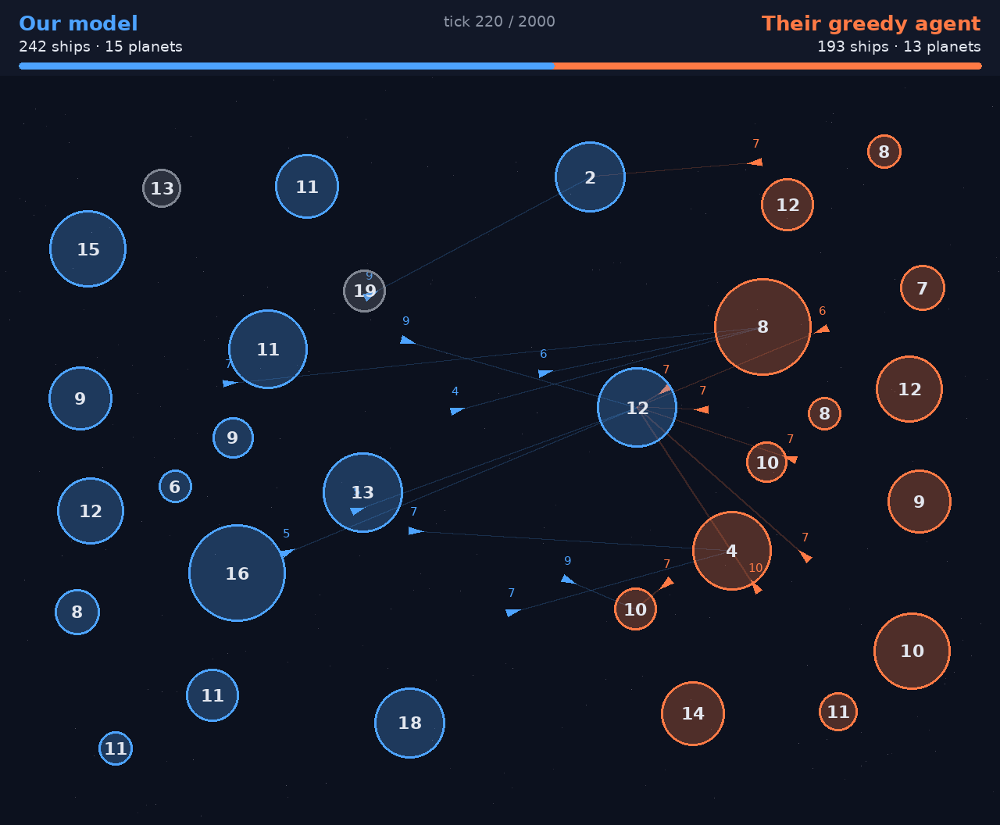

# Planet Wars RTS entry, trained with JAX

An entry for Simon Lucas's [Planet Wars RTS](https://simonlucas.github.io/planet-wars-rts/) league.
The entry served by default is an all-moves planner (`entry/planner.py`) whose best few launches are
re-ranked by a small network trained on the results of planner games (`entry/value.npz`), checking the opponent's
best answers to its eight best options before it picks one. Without that
file, or with `PW_VALUE=off`, it ranks launches by a hand-written score alone. A neural network
trained by self-play on a GPU is also in the repo (`PW_AGENT=neural`); the planner beats it in 57 of 60
games. The game itself is untouched: we port its rules to JAX so thousands of games run in parallel,
then ship a numpy copy of the network in their Python entry format.

```
planetwars/
  pwjax/           training code (JAX)
    maps.py        map generator, same as their Kotlin GameStateFactory + GameParamGenerator
    env.py         the forward model (ForwardModel.kt / forward_model.py), rule for rule
    baselines.py   their Greedy Heuristic and Careful Random sample agents
    policy.py      sampling and log-probabilities for PPO
    ppo.py         self-play PPO against itself, older snapshots and the sample agents
    evaluate.py    win rates against the sample agents or another model
    planner.py     the planner in JAX (checked against entry/planner.py)
    lvalue.py      planner games, value training and head-to-head tests for the learned value
  entry/           the competition entry (copy to the root of a repo to submit)
    Dockerfile     their Python template: python:3.11-slim, port 8080
    main.py        GameServerAgent(host="0.0.0.0", port=8080, agent=PlannerAgent()); PW_AGENT=neural serves the network
    planner.py     the all-moves planner (numpy only), the default agent
    value.npz      value network that re-ranks the planner's best launches (round 6, trained on planner games)
    agent.py       the neural agent (numpy only)
    pwnet.py       features + network, shared verbatim with training (numpy or jax.numpy)
    model.npz      trained weights (self-play iteration 450)
    selfcheck.py   play the official sample agents in the official Python engine
    core/ agents/ client_server/   vendored from planet-wars-rts (MIT, see LICENSE-planet-wars-rts)
  tests/           parity tests against the official engine
  tools/           record_game.py (render a game as an MP4), remote_match.py, TraceGame.kt + render_trace.py + aura.py (our entry vs TeamTitansAgentV3 as an MP4, Auralux-style with sound)
  media/           recorded games: against their greedy agent, and two against TeamTitansAgentV3
```

## How the agent works

### The planner (default)

Each tick it tries every launch the rules allow: every free planet of ours, every other planet as the
target, and a quarter, half or all of the source's ships. Each is projected 90 ticks ahead with nobody
launching anything else, and scored by where the game stands then: ship difference on planets, ten times
the growth difference, half the difference in ships after another 20 ticks of growth, five per planet of
lead, a small penalty for planets with no friendly planet within 160, and a huge value for winning or
losing outright. The best move is played, or nothing if no launch beats waiting.

With no new launches, a planet's future depends only on the fleets already heading for it, and a launch
changes just two planets, the source (now smaller) and the target (one more arrival). So all of the
roughly 1,000 moves are projected at once as arrays, about 5 ms a move on a 30-planet map, against the
200 ms limit. `tests/test_planner.py` checks the projection against the official engine tick for tick.

It came out of studying eight games against TeamTitansAgentV3 (league rank 19): the opening was level,
but from about tick 100 it captured more enemy planets (26 a game to our network's 20) with bigger
fleets, and moved about 2,750 ships between its own planets to the network's 230. Its public code tries
every launch and projects each one ahead, which is the idea here. The projection, the scoring and the
code are our own; the scoring terms follow what its code scores.

Local results on league-style maps, both sides (the trained network's score in brackets):

| Opponent | Planner wins | Network (iteration 450) |
|---|---:|---:|
| The network, iteration 450 | 57 / 60 | |
| TeamTitansAgentV3 (league #19) | 21 / 32, then 9 / 16 in the Docker image | 1 / 72 |
| sebba14-v2 (#25) | 32 / 36 | 10 / 36 |
| genetic_v1 (#36) | 18 / 20 | 53 / 80 |
| GalacticArmada (#34) | 20 / 20 | 74 / 80 |
| AggressiveGreedy | 20 / 20 | 60 / 80 |
| BetterGreedy, CarefulGreedy | 20 / 20 each | 80 / 80 each |
| Their greedy agent | 60 / 60 | 99 / 100 |
| Their careful random, better random, SimpleEvoAgent | 16 / 16 each in the Docker image | 100 / 100 each |

Samples are small (about plus or minus 8 points) and games shared four CPU cores. Average move 4 to 7 ms,
slowest seen 58 ms, no timeouts at 200 ms.

Tuning, planner against planner over 40 games each: a 90-tick horizon beat 50 (68%), 130 (65%) and 110
(60%) and tied 70; fleet sizes of a quarter, half and all matched finer or larger sets (50% and 48%);
adding the network's own move as a candidate did worse (45%).

### The planner with a learned value (default)

The hand-written score is the weak point of the planner, so a network now helps rank launches. Each tick
the planner still projects every launch, but only its best eight by hand score (and waiting) go on:
the projected position of each is shown to a value network, and the launch with the best
`0.5 * network + 0.5 * tanh(hand score / 200)` is played. The network is the same transformer as the
policy (3 layers, 128 wide), and only its value output is used. It sees the projected position, with no
fleets in flight and the clock moved on to the tick the projection ends at, and predicts who ends up
with more ships on planets (+1 win, -1 loss).

It was trained on planner games, not on the policy's, in three rounds (`python -m pwjax.lvalue gen`, `train`, `match`).
Round 1: 32,000 games on random league maps, each side with its own look-ahead (60 to 100 ticks), some random
launches, and one side in ten playing their greedy agent. Every 8 ticks the position each side's chosen launch
leads to was recorded and labelled with the game's result: 8 million positions, about ten minutes of games on one
A100. With only 8,000 games the network memorised them (held-out error rose while training error fell), so the
data matters more than the network size. Rounds 2 and 3: 16,000 more games each in which the previous round's
network played (alone, or mixed half and half with the hand score, against either), then training continued on
everything so far. On held-out games the round 3 network's error is 0.343 and it picks the winner 87.1% of the
time; the hand score, rescaled to fit the results as well as it can be, gets 0.389 and 85.4%.

The gain shows up much more in play than in the error. Head to head in JAX, 512 league maps, both sides, 1,024
games (the Titans games are in the real engine, 32 games):

| Opponent | Round 3 | Round 2 | Round 1 | Hand-scored planner |
|---|---:|---:|---:|---:|
| The hand-scored planner | 986 / 1,024 | 979 / 1,024 | 874 / 1,024 | |
| The previous round's value planner | 679 / 1,024 | 714 / 1,024 | | |
| TeamTitansAgentV3 (league #19), 200 ms | 30 / 32 | 32 / 32 | 31 / 32 | 24 / 32 |
| Their greedy agent | 1,018 / 1,024 | 1,019 / 1,024 | 1,008 / 1,024 | 994 / 1,024 |
| The trained network, iteration 450 | 997 / 1,024 | 993 / 1,024 | 948 / 1,024 | 922 / 1,024 |

Round 3 ships. Against fixed opponents the rounds are close to saturated (the Titans differences are within the
noise of 32 games); the one clear difference between rounds is in playing each other, where each round beat the one
before about two games in three. The Titans games ran in the Kotlin runner against the entry's Python server: 21 to
24 ms a move on average, no timeouts at 200 ms (35 ms on a 30-planet map in a separate timing run, slowest 78 ms).
`PW_TOP`, `PW_MIX` and `PW_VALUE` change the number of launches re-ranked, the mix and the weights file (`off` for the
hand score alone); `PW_BUDGET_MS` caps the time spent re-ranking. `tests/test_planner.py` checks the JAX planner against the numpy one, and the numpy value ranking
against the JAX one. Every round learns from its own predecessor's games, so a fourth round would measure itself more
and more against a planner it already beats; the real test is the league's other agents.

**More candidates.** The hand score picks which launches the network gets to see, and that turned out to limit
strength more than the network did. The same round 3 network re-ranking more of the hand score's best launches, in
JAX, 1,024 games against itself re-ranking fewer (score counts a draw as half):

| Re-ranks | Against | Score |
|---|---|---:|
| 4 launches | 8 | 0.316 |
| 12 launches | 8 | 0.645 |
| 16 launches | 8 | 0.713 |
| 24 launches | 16 | 0.667 |
| 32 launches | 16 | 0.702 |

A fourth round of self-play (16,000 games with 16 launches re-ranked, round 3 and round 2 as the opponents, training
continued from round 3) did not improve on round 3: head to head at 16 launches it won 485 of 1,024 games (a score of
0.474), so round 4 was not used. The gain from here came from looking at more launches, not from more rounds; the next
section, which adds the dense targets, is the round that did help.

The entry re-ranked up to 32 launches at first. Time is the limit, so it works through them in chunks of 8, best hand
score first, and stops when 90 ms are spent, then picks the best seen so far. Against TeamTitansAgentV3 in the Kotlin
runner: 32 of 32 games, 0 timeouts at 200 ms, 21 ms a move on average.

Later, with the round 6 network and `spare`, more launches still paid (JAX, 1,024 plays each, against itself at 32):
48 launches scored 0.562 and 64 scored 0.592, more than a round of training gives. To afford them, the entry now works
out the features of all re-ranked positions at once and does attention with batched matrix products instead of
`einsum`, about twice as fast (on a 30-planet map, 64 launches in about 60 ms instead of 150 ms). It now re-ranks up to
64 (`PW_TOP`). In a timing run over 768 moves on league maps, one core: 48 ms a move on average, slowest 87 ms.
Against TeamTitansAgentV3 in the Kotlin runner at 64 launches: 32 of 32 games, no timeouts, 23 ms a move on average.

**Dense targets, and launch sizes.** Two changes, tried together on an A100 (about 24 Colab compute units in all).

*Dense targets.* The value head only ever saw the game's final result. Round 5 trains the same network to predict, in
extra outputs the entry does not use (`aux.w`, `aux.b`), how the position scores 24, 48 and 96 ticks later (the hand
score of the real position, squashed with tanh(score / 200)), alongside the result. The games are the round 4 recipe
(sides play the hand score 15% of the time, the round 3 network alone 20% or mixed with the hand score 35%, and an older
network 30%; 16 launches re-ranked; 12 batches of 1,024 games; training continued from round 3 for 8,000 steps) with those
targets added.
Head to head at 16 launches, round 3 against round 5, in JAX:

| Maps | Plays | Round 5 wins | Round 3 wins | Score |
|---|---:|---:|---:|---:|
| 512 | 1,024 | 554 | 470 | 0.541 |
| 1,024 (other maps) | 2,048 | 1,111 | 936 | 0.543 |

Round 4, with no dense targets, scored 0.474 on the same test, so the targets look like what made the difference (one
run of each, so the size of the effect is uncertain). Longer training did not help: on held-out games the error
was lowest after 500 of the 8,000 steps (0.307, picks the winner 88.7% of the time, against 0.314 and 88.5% for round 3
on the same games) and rose after that (0.341 at the end) while the training loss kept falling. The network memorises
the games, since every position of a game carries the same result, so round 5 is the step-500 checkpoint
and more games, not more steps, is what would help.

*Launch sizes.* A launch is a fraction (a quarter, half, all) of the source's ships. The planner can now also try sizes
worked out from its own projection: `spare` (everything the source can do without, its smallest garrison over the
projection, or nothing if the projection loses the planet), `cap` (just enough to take the target when the fleet lands)
and extra fractions (`f:0.9`). `python -m pwjax.lvalue gauntlet` picks sizes by playing every candidate size added to the
current set against the current set, on the same maps and from both sides, and keeps one only when it wins by two standard
errors. Results (a score of 0.5 is even):

| Agent | Added size | Plays | Score |
|---|---|---:|---:|
| Hand-scored planner | `f:0.9` | 512 | 0.557 (kept) |
| Hand-scored planner | `spare` | 512 | 0.543 |
| Hand-scored planner | `cap`, `cap:1.2:1`, `cap:1.5:3` | 512 each | 0.455 to 0.498 |
| Round 3 network, 12 launches | best (`spare`) | 512 | 0.518 (nothing kept) |
| Round 5 network, 16 launches | `spare` / `spare:0.5` / `cap:1.2:1` | 512 each | 0.533 / 0.520 / 0.504 (nothing kept) |
| Round 5 network, 16 launches | `f:0.75` / `f:0.9` | 512 each | 0.371 / 0.379 |
| Round 5 network, 32 launches | `spare` | 512 | 0.547 (kept, needed 0.544) |
| Round 5 network, 32 launches | `f:0.9` / `f:0.75` | 512 each | 0.387 / 0.398 |

`spare` is the one that holds up: 0.522 at 16 launches and 0.538 at 32 launches in a longer test (2,048 plays each, round 5
network with `spare` against the same network without). Extra fractions hurt a network that only sees 16 or 32 launches:
they fill its slots with near-copies of the same move. Keeping only the best size for each source and target made it much
worse (0.278), so the network is using the choice of size, not just the choice of move. A network trained on games played
with `f:0.9`, `spare` and `cap:1.2:1` in the mix (round 5b) did not do better with them (0.475 against round 3, and it lost
to round 5, 0.539 for round 5); the gauntlet found nothing to add for it either.

Round 5 with `spare` (`PW_SIZES=spare`, empty for none) at 32 launches, against the
round 3 network at 32 launches, in JAX: 1,197 to 851 of 2,048 plays (0.585). Against the hand-scored planner: 2,017 to 31.
The numpy planner's launch sizes are checked against the JAX ones in `tests/test_planner.py`.

In the real engine (Kotlin runner, 200 ms limit) the round 5 entry beat TeamTitansAgentV3 in 32 of 32 games with no
timeouts, 32 ms a move on average (the round 5 network alone, without `spare`, won 94 of 96 in three runs). Against the
previous entry (round 3 network, no `spare`) it won 25 of 48 games (0.52), which cannot tell a 0.585 player from an
even one at this sample size: the JAX test above is the evidence for the gain, and the league is the real test.

**Round 6.** The next round, same recipe, was played by round 5 with `spare` (about 12,000 games, the round 3 network as
the older opponent), with training continued from round 5 and checked on held-out games every 100 steps. Held-out error
went from 0.263 (round 5 on these games) to 0.255 at step 600 and wandered after that, so step 600 is kept. Head to head,
both with `spare` at 32 launches, in JAX: round 6 beat round 5 1,101 to 947 of 2,048 plays (0.538). The entry now ships
round 6 (`entry/value.npz`) with `spare`. In the real engine it beat TeamTitansAgentV3 in 32 of 32
games, no timeouts at 200 ms, 19 ms a move on average.

**Looking one reply ahead.** The projection assumes nobody launches anything more, so the planner cannot see a
counter-attack on a planet it has just emptied. Now the eight best options by the mixed score (waiting included) are
each played on a copy of the game, the opponent's planner finds its four best answers by its own hand score (launches
from its 12 planets with the most free ships, same sizes), and the network scores the position after each answer. An
option is worth the worst of these and its own score, and the best by that is played (`PW_LOOK=8:4`, the default;
empty turns it off). Head to head in JAX (`lvalue match --reply`, 512 league maps from both sides, round 6 network
with `spare`), against the same planner without it at 64 launches:

| Look-ahead | Launches re-ranked | Score of 1,024 |
|---|---|---|
| 8 options, 4 answers each | 64 | 0.584 |
| 16 options, 4 answers | 64 | 0.570 |
| 8 options, 8 answers | 64 | 0.558 |
| 8 options, 4 answers, worst case averaged with the plain score | 64 | 0.550 |
| 8 options, only the opponent's best answer | 64 | 0.530 |
| 8 options, 4 answers | 48 | 0.548 |
| 8 options, 4 answers | 32 | 0.474 |
| 4 options, 4 answers | 64 / 48 | 0.544 / 0.538 |

Looking ahead is worth about as much as doubling the launches re-ranked, so the two compete for the time. The entry
finds the answers without stepping copies of the game (`replies` in `entry/planner.py`): a launch changes the
projection only on its two planets, an answer's planets are stepped only at the ticks fleets land on them, and an
answer's hand score is worked out from the two planets it changes. That takes about 4 ms and finds the same answers as
the JAX version (scores checked on 189 options). Scoring the 32 answered positions takes most of the time, so
re-ranking stops early enough to leave room for it, and fewer options look ahead when time is short. On league maps,
one core: 66 ms a move on average, slowest 88 ms; maps of 22 or more planets re-rank about 50 launches instead of 64,
smaller ones all of them. In the real engine the entry with look-ahead beat the entry without it in 21 of 32 games,
and TeamTitansAgentV3 in 63 of 64 (two series at once, no timeouts, slowest move 102 ms).

Two more ideas did not make the cut. Two-fleet attacks (`duo` in `pwjax/planner.py`: two planets send what they can
spare to one target a tick apart, scored as if both go) lost 374 to 650 against the planner without them: the first
fleet goes out on the promise of a second that the next tick's ranking often does not send. Re-ranking 128 launches
instead of 64 scored 0.533 in JAX (96: 0.530), but under load moves took up to 150 ms and one in 64 games timed out.
A seventh round of training (same recipe, played by round 6) lost to round 6 (975 to 1,073) and was not used.

The earlier value network in "A value function trained on game results (did not help)" below was asked a
different question, which of the policy's own moves is worth most, and the policy's moves were not where
the gap was.

### The neural network

Each tick the network looks at every planet (owner, ships, growth, position, fleets in flight and
fleets heading to it) through a small transformer, then scores every legal (source, destination)
launch plus "do nothing", and picks a fleet size: a quarter, half, three quarters or all of the
source's ships, or just enough to take the target (with or without a margin). Player 2 sees the
map mirrored, so the network always plays from the left.

## Results

Training ran on Colab L4 GPUs and stopped when the iteration-550 snapshot won only 37% of its games
against iteration 450, so iteration 450 is the model in `entry/model.npz`. Win rates come from
`pwjax.evaluate` on fresh league maps, each played from both sides (128 to 256 games per row);
"stronger bot" is our own hand-written agent that sends just enough ships.

| Iteration | vs their greedy agent | vs our stronger bot | vs the iteration before |
|---:|---:|---:|---:|
| 0 (copies greedy) | 50% | 39% | |
| 125 | 84% | 89% | 83% (vs 0) |
| 150 | 92% | 93% | 81% (vs 125) |
| 225 | 98% | 95% | 80% (vs 150) |
| 275 | 99% | 96% | 76% (vs 225) |
| 325 | 100% | 96% | 73% (vs 275) |
| **450 (shipped)** | 99% | 98% | 86% (vs 325) |
| 550 | 98% | 98% | 37% (vs 450) |

Iteration 450 also passes their own submission check (`runEvaluation` in their Kotlin repo) 12 of 12
games against their sample agents, with no timeouts and a 9 ms average move.



[Watch the whole game](media/game_vs_greedy.mp4): our model wins on a 30-planet league map at tick 722.
Record another with `python tools/record_game.py --seed 7 --out game.mp4`.

The current entry (planner with the learned value) against TeamTitansAgentV3, the first two games recorded
(the other two recorded were wins as well): [as Player 1 (blue), a win by wiping out Titans at tick 480 on a 16-planet map](media/game_vs_titans_1.mp4)
and [as Player 2 (orange), a win at tick 969 on a 24-planet map](media/game_vs_titans_2.mp4). Titans only runs on the JVM, so
`tools/TraceGame.kt` (drop it in `app/src/main/kotlin/games/planetwars/runners/` of their repo) plays the game there against the
entry's server and writes the map and every launch; `python tools/render_trace.py trace.jsonl --out game.mp4` replays that in the
JAX rules, which match the official engine tick for tick (it checks the final ship counts), and draws it: glowing orbs with a dot
orbiting for each ship, swarming fleets and ripples as in Auralux, with a synthesized ambient pad, a pluck for each launch, a thump
for each hit and a chime when a planet changes hands (`--style classic` for the plain silent version). The two videos in `media/`
are the plain ones; the Auralux-style versions are about 5 and 10 MB and are kept with the project files, not in git.

## Checks

```bash
cd planetwars
python -m pytest -q tests          # JAX rules == official Python engine; numpy entry == JAX policy
python -m pwjax.evaluate entry/model.npz --games 256 --vs greedy,random
cd entry && python selfcheck.py    # official engine, submission-check settings (--agent neural for the network)
```

The parity tests replay fuzzed games (legal and illegal actions) in both engines and compare every
planet and fleet each tick; their greedy agent's moves are compared too.

## Training

```bash
pip install "jax[cuda12]" optax
python -m pwjax.ppo --out runs/pw1 --envs 2048 --iters 3000
python -m pwjax.evaluate runs/pw1/latest.npz --games 512
cp runs/pw1/latest.npz entry/model.npz
```

Maps follow the league's `GameParamGenerator.randomParams()` (10 to 30 planets, transporter speed
2 to 5, growth 0.05 to 0.2), with some default-rule maps mixed in because the submission check
plays 20-planet default maps for 1000 ticks.

### Past iteration 450

Every attempt to carry on from the iteration 450 weights (about 30 minutes each on an A100, 58M to
136M steps) drifted below it when played head-to-head, and none produced a clearly stronger model.
"Gate" is the new model's score against 450 during training (64 to 128 maps, both sides, argmax play);
the final columns are the end-of-run model on 256 maps.

| Run | Best gate vs 450 | Final vs 450 | Final vs rush bot |
|---|---:|---:|---:|
| Old settings: learning rate 1e-4, entropy 0.003 to 0.001 | 57% (iteration 80) | 18% | 80% |
| Rush bot and anchors, learning rate 2e-4, entropy 0.005 to 0.002 | 27% | 30% | 88% |
| Rush bot and anchors, learning rate 1e-4 decayed to 5e-6, entropy 0.003 to 0.001 | 55% (iteration 80) | 30% | 93% |
| The same with one epoch per batch and twice the batch | 48% | 36% | 90% |
| The same, grown to 6 layers | 46% | 18% (gate, iteration 140) | not run |
| The same, grown to 6 layers, learning rate 3e-4 decayed to 1e-5 | 37% | 27% (gate, iteration 140) | not run |

Iteration 450 itself scores 84% against the rush bot (the greedy agent sending every ship), 99%
against greedy and 99% against our stronger bot. The snapshot at iteration 80 of the decayed-rate
run played level with 450 (52%) and beat the rush bot 90% of the time; it is not shipped.

Options added for these runs, all off by default: `--opp-probs` takes a fifth value for the rush
bot, `--anchors a.npz,b.npz` keeps frozen models in the opponent pool, `--gate-every N` plays the
learner against the best model so far and keeps the winner in `best.npz`, `--lr-end` decays the
learning rate, and `python -m pwjax.grow in.npz out.npz --layers 6` adds layers that start as
no-ops, so the deeper model plays exactly like the original.

### Look-ahead search (not used)

`entry/search.py` puts a short search on top of the model: candidate moves are played on a copy of the
game with the official rules, both sides then follow a cheap scripted player for 40 to 50 ticks, and
the model's value estimate scores the result. `SearchAgent` is not wired into `main.py`; to try it,
serve `SearchAgent()` there instead of `NeuralAgent()`. It did not make the agent stronger:

| Version | Result |
|---|---|
| Network's top 8 moves, greedy fast-forward | 6 of 6 against greedy; 2 of 24 against TeamTitansAgentV3 (plain model: 1 of 72) |
| Best target per free planet, greedy's move and no-op, greedy fast-forward | 37 of 80 (46%) against the plain model |
| The same, no further launches during the fast-forward | 34 of 80 (43%) against the plain model |

The model puts about 99% of its probability on one move, usually doing nothing, so its next-best
moves are not meaningful candidates, and the value estimates of candidate moves differ by about
0.02, which is too small to choose between them reliably. A search would need a value function
trained to rank moves, not only to predict the final result.

### A value function trained on game results (did not help)

The AlphaZero-style test of that last sentence: train a value network on who won, then use it to pick
moves.

`python -m pwjax.vtrain` plays batches of 2048 games on the GPU between a mix of players (iterations 325,
450 and 550, an early snapshot and the behaviour-cloned starter, each at temperature 0.7 to 1.5 and with up to 6% random moves, plus
the greedy, rush and careful-random bots), records a position every 16 ticks, labels each with the
result, and regresses a copy of the network onto those labels. 51 batches (about 100,000 games, 6
million positions, about 30 minutes on an A100) were enough; the held-out error stopped improving after
about 10. On 1024 held-out games, squared error against the result (lower is better; the others are
rescaled to fit, which flatters them):

| Predictor | Error | Right side of a decided game | Error by game phase (0-10%, 10-25%, 25-50%, 50%+) |
|---|---|---|---|
| New value network | 0.385 | 85.3% | 0.68, 0.37, 0.25, 0.33 |
| Iteration 450's own value output | 0.473 | 82.3% | 0.83, 0.48, 0.32, 0.37 |
| Ship share | 0.642 | 81.1% | 0.92, 0.68, 0.52, 0.53 |

So it predicts the result better than the old output, mostly in the middle game. It does not choose
better moves. `python -m pwjax.qprobe` takes 896 positions from the same kind of games, tries each of
`vsearch.candidates` (the policy's move, doing nothing, the best-aimed launch from each of its top 6
planets, greedy's move; about 3.6 of the 9 are distinct), and finishes the game 12 times from each,
both sides sampling the policy, to measure what each move is worth. Results on a scale where a win is
+1 and a loss is -1:

| | Gain over the policy's own move |
|---|---|
| Best candidate, picked on half the rollouts and scored on the other half | +0.027 ± 0.012 (384 positions), +0.009 ± 0.011 (512 positions) |
| Look-ahead scored by the new value network (1, 5, 10, 20 or 40 ticks, greedy or idle fast-forward) | between -0.009 and +0.011, every one within about one standard error of zero |
| The same with iteration 450's own value output | between -0.009 and +0.006 |

The candidates' worth differs by only 0.07 (standard deviation) in a typical position, and a look-ahead
score ranks them with a rank correlation of 0.23 to 0.28 for both value functions. Picking the best of these
moves from six rollouts gains 0.01 to 0.03 per decision, which is half a point to a point and a half of
win rate, and head-to-head play with the search on the early value network gave 118 wins and 138
losses against the plain model over 256 games (46%).
The gap to the best agents is therefore not in single-move choice, and a better value function alone
will not close it.

`python -m pwjax.vsearch` is the same search as a JAX agent for head-to-head games. The trained value
network is kept outside the repo, since nothing uses it.

## Submitting

Their bot builds the `Dockerfile` at the root of a repository, so the entry goes in a repo of its
own (the `entry/` folder as its root), then a submission issue on
`SimonLucas/planet-wars-rts-submissions` names that repo at a specific commit.
